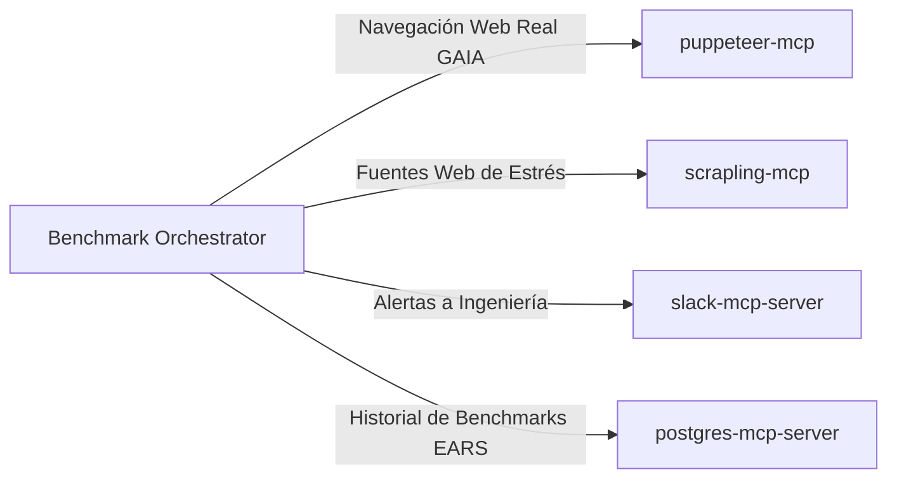

# MCP_INTEGRATION.md — AGENT EVALUATION FRAMEWORK
## Integración de Servidores Model Context Protocol (Zero-Docker Native)

> **Directiva Mandatoria:** Cero dependencias de contenedores Docker. Todos los servidores se ejecutan nativamente en el host mediante `npx` (Node.js) o `uvx` (Python).

---

## 1. Servidores MCP Asignados

| Servidor MCP | Runtime / Transporte | Propósito Operativo |
| :--- | :--- | :--- |
| **`puppeteer-mcp`** | `npx -y @modelcontextprotocol/server-puppeteer` (`stdio`) | Ejecución de escenarios GAIA en navegador web real: clic, relleno de formularios, extracción y capturas de pantalla. |
| **`scrapling-mcp`** | `uvx scrapling-mcp` (`stdio`) | Simulación de fuentes de datos web adversariales o fluctuantes para evaluar resiliencia de extracción. |
| **`slack-mcp-server`** | `npx -y @modelcontextprotocol/server-slack` (`stdio`) | Notificación en canal de ingeniería `#ai-certifications` tras la finalización de una sesión de benchmarking. |
| **`postgres-mcp-server`** | `npx -y @modelcontextprotocol/server-postgres` (`stdio`) | Repositorio histórico de benchmarks: puntuaciones EARS, logs de ejecuciones y curvas de regresión entre modelos. |

---

## 2. Configuración Nativa de Referencia (`mcp_config.json`)

```json
{
 "mcpServers": {
 "puppeteer": {
 "command": "npx",
 "args": ["-y", "@modelcontextprotocol/server-puppeteer"]
 },
 "scrapling": {
 "command": "uvx",
 "args": ["scrapling-mcp"]
 },
 "slack": {
 "command": "npx",
 "args": ["-y", "@modelcontextprotocol/server-slack"],
 "env": {
 "SLACK_BOT_TOKEN": "${SLACK_BOT_TOKEN}"
 }
 },
 "postgres_benchmarks": {
 "command": "npx",
 "args": ["-y", "@modelcontextprotocol/server-postgres", "${POSTGRES_BENCHMARK_URI}"]
 }
 }
}
```

---

## 3. Arquitectura de Conexión de Herramientas de Prueba


