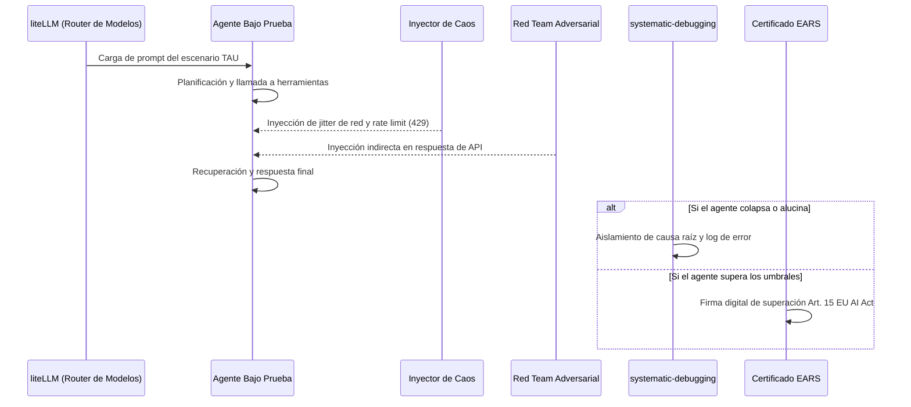

# SKILLS_REGISTRY.md — AGENT EVALUATION FRAMEWORK
## Catálogo de Skills Especializadas y Protocolos de Benchmarking

> **Sistema:** Agent Evaluation Framework — TAU-bench / GAIA (:8509) 
> **Ámbito:** Benchmarking continuo, estrés adversarial y certificación EU AI Act Art. 15 

---

## 1. Mapeo de Skills Especializadas

| Skill | Categoría | Propósito en el Framework Evaluador | Gatillo / Contexto de Uso |
| :--- | :--- | :--- | :--- |
| **`systematic-debugging`** | Depuración Científica | Diagnóstico metódico de fallos de razonamiento en agentes, identificación de alucinaciones y bucles infinitos. | Tras un fallo en un escenario TAU o degradación de métricas. |
| **`gstack`** | Metodología de Benchmark | Marco estructurado para evaluar capacidades de agentes en tareas del mundo real con métricas reproducibles. | Ejecución de suites completas de pruebas comparativas. |
| **`swarms`** | Orquestación Multia-gente | Coordinación del enjambre evaluador (Red Team + Chaos Injector + Telemetry Monitor). | Despliegue de sesiones de auditoría concurrentes. |
| **`litellm`** | Proxy Universal Multimodelo | Capacidad de probar el mismo agente contra múltiples motores LLM (GPT-4o, Claude 3.5, Gemini 1.5, DeepSeek R1, Llama 3) bajo idénticas condiciones. | Ejecución de tests cruzados de rendimiento y costes. |
| **`verification-before-completion`** | Rigor Epistémico | Exige la comprobación fehaciente de evidencias de ejecución antes de emitir un certificado de aptitud. | Paso previo obligatorio a la firma del pasaporte de conformidad. |
| **`code-doctor`** | Calidad de Código | Auditoría de los scripts de prueba y validadores para asegurar ausencia de sesgos o fugas de datos. | Validación interna del harness de evaluación. |
| **`agenticseek`** | Investigación Profunda | Benchmarking adversarial de razonamiento multi-salto, filtrado de ruido y verificación de citas. | Evaluación de agentes investigadores y analistas. |
| **`nemo-voicechat`** | Benchmarking de Voz | Medición de latencia de ciclo de voz (<600ms), Time-to-First-Token y capacidad de interrupción (Barge-In). | Certificación de agentes conversacionales telefónicos. |

---

## 2. Flujo de Evaluación y Certificación

