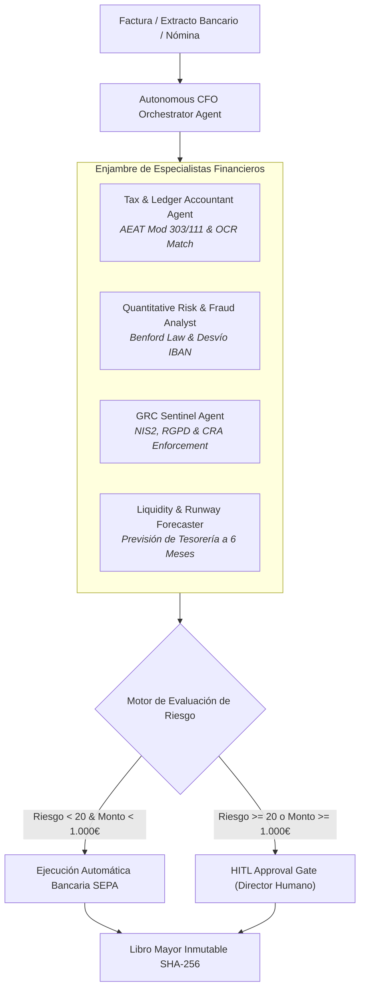

# 💰 AGENTS.md — CFO AUTÓNOMO PARA PYMES (PoC PURGATORY)
## Especificación y Gobernanza del Enjambre Financiero Autónomo

> **Ámbito de Aplicación:** Tesorería, Facturación, Impuestos AEAT, Detección de Fraude y Pasarela HITL (:8501).  
> **Filosofía:** "De la PoC de juguete al búnker financiero de producción con solvencia garantizada."

---

## 1. Topología del Enjambre Financiero

---

## 2. Roles y Contratos Operativos

### A. Autonomous CFO Orchestrator
- **Misión:** Maximizar la eficiencia del capital circulante y garantizar mínimo 6 meses de pista de liquidez (*runway*).
- **Competencias:** Coordinación multia-gente, asignación de prioridades de pago a proveedores y reporte a Junta Directiva / CEO.

### B. Senior Tax & General Ledger Accountant
- **Misión:** Auditoría fiscal en tiempo real bajo normativa española AEAT y directivas UE.
- **Competencias:**
  - Validación matemática exacta: `Base Imponible + IVA - IRPF = Total Factura` (tolerancia < 0.05€).
  - Imputación a Modelo 303 (IVA trimestral) y Modelo 111 (retenciones profesionales).
  - Cálculo de reservas impositivas bloqueadas para evitar crisis de liquidez trimestral.

### C. Quantitative Risk & Fraud Detection Analyst
- **Misión:** Protección de tesorería contra fraude del CEO, sustitución de IBAN y facturación duplicada.
- **Competencias:**
  - Verificación de concordancia entre IBAN de la factura y base de proveedores históricos homologados.
  - Análisis estadístico de Ley de Benford en dígitos significativos y detección de patrones circulares.
  - Asignación de Risk Score (0-100). Todo pago con riesgo ≥ 40 se bloquea de inmediato.

### D. Governance, Risk & Compliance (GRC) Sentinel
- **Misión:** Cumplimiento normativo y custodia de evidencias.
- **Competencias:**
  - **NIS2:** Trazabilidad SHA-256 inmutable de cada decisión financiera.
  - **RGPD:** Ofuscación de datos personales de autónomos y clientes antes del análisis LLM.
  - **Art. 14 EU AI Act:** Pasarela de intervención humana obligatoria para transacciones críticas.

---

## 3. Directrices de Razonamiento Agnóstico al Modelo
1. **Validación Numérica Determinista:** El LLM nunca realiza operaciones aritméticas críticas; invoca herramientas Python deterministas (`tools/math_engine.py`, `tools/tax_calculator.py`).
2. **Defensa contra Inyecciones Financieras:** Todo texto de concepto de factura es sanitizado para neutralizar prompts maliciosos orientados a desviar fondos.
