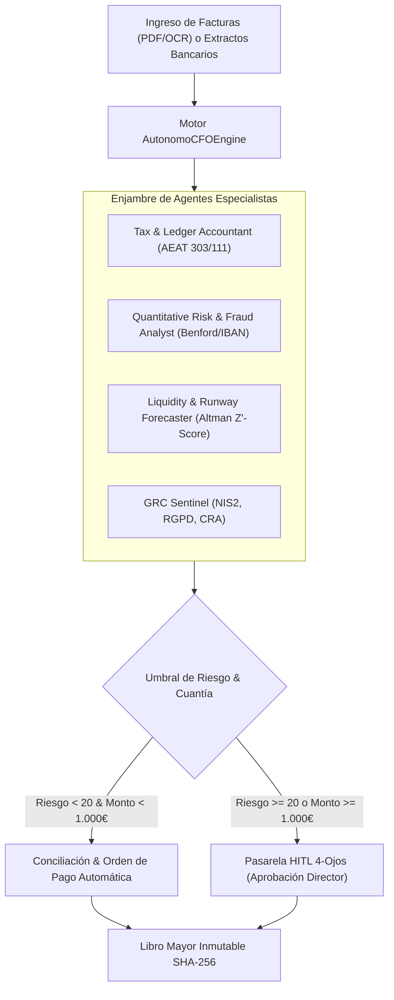

# 📖 MANUAL DE USO Y OPERACIÓN — CFO AUTÓNOMO PARA PYMES
### *Guía Táctica de Operación para Directores Financieros y Control de Gestión*

---

## 1. Visión y Operativa del Enjambre Financiero

El **CFO Autónomo** demuestra cómo escapar del *PoC Purgatory* empresarial conectando la inteligencia artificial directamente a la tesorería, al ERP y a las obligaciones fiscales:



---

## 2. Puesta en Marcha

### Modo 1: Lanzador de Un Clic
Doble clic sobre el script de inicio:
```bat
INICIAR_CFO_AUTONOMO.bat
```
El servidor Streamlit se iniciará en el puerto dedicado:
👉 **`http://localhost:8501`**

### Modo 2: Validación Automatizada
Para verificar los 17 tests unitarios de cálculo contable y criptografía:
```powershell
python -m pytest tests -v
```

---

## 3. Guía Paso a Paso en el Panel de Control

### Pestaña 1: 📊 Dashboard Financiero & Altman Z'-Score
- **Solvencia en Tiempo Real:** Monitoriza el índice Altman Z' para predecir insolvencias con hasta 2 años de antelación.
- **Runway & Burn Rate:** Visualiza el flujo de caja proyectado a 30, 60 y 90 días vista.
- **Reservas Tributarias:** Cuantifica la provisión bloqueada de IVA e IRPF para evitar sustos de liquidez al cierre de trimestre.

### Pestaña 2: 📥 Carga y Procesamiento de Facturas
1. Arrastre una factura de proveedor en formato PDF o imagen.
2. El motor OCR estructurado extrae: CIF/NIF, Base Imponible, Tipo de IVA, Retención IRPF y Total.
3. El analizador de fraude verifica:
   - Que el IBAN coincida con el registro histórico de proveedores verificados.
   - Distribución de dígitos significativos bajo la Ley de Benford.
   - Ausencia de facturas duplicadas.

### Pestaña 3: 👁️ Centro de Aprobaciones 4-Ojos (HITL Gate)
- Conforme al **Artículo 14 del EU AI Act**, cualquier factura superior a 1.000 € o con un score de riesgo $\ge 20$ queda suspendida en cola de revisión.
- El director financiero revisa el detalle y pulsa **"Aprobar y Firmar"** o **"Rechazar"**.

### Pestaña 4: ⛓️ Auditoría NIS2 y Trazabilidad Inmutable
- Cada decisión contable genera una entrada en el archivo `audit_nis2_ledger.jsonl`.
- Pulse **"Verificar Integridad de Cadena"** para validar en segundos que todos los hashes SHA-256 encadenados se mantienen intactos.

### Pestaña 5: 📄 Emisión de Dossiers Financieros
- Descargue el informe pericial completo en PDF para el Comité de Dirección o para entidades bancarias y auditores.

---

## 4. Skills y Servidores MCP Utilizados

Consulte los detalles técnicos en:
- [AGENTS.md](./AGENTS.md): Gobernanza de roles (`CFOOrchestrator`, `TaxAccountant`, `RiskFraudAnalyst`, etc.).
- [SKILLS_REGISTRY.md](./SKILLS_REGISTRY.md): Catálogo de skills (`demand-forecasting`, `sap-integration`, `shadow-office-scripts`, etc.).
- [MCP_INTEGRATION.md](./MCP_INTEGRATION.md): Integración con `stripe-mcp`, `odoo-mcp-server`, `postgres-mcp-server` y `mailgun-mcp-server`.
