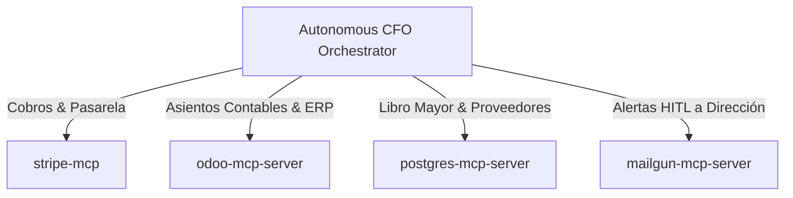

# 🔌 MCP_INTEGRATION.md — CFO AUTÓNOMO PARA PYMES
## Integración de Servidores Model Context Protocol (Zero-Docker Native)

> **Directiva Mandatoria:** Cero dependencias de contenedores Docker. Todos los servidores se ejecutan nativamente en el host mediante `npx` (Node.js) o `uvx` (Python).

---

## 1. Servidores MCP Asignados

| Servidor MCP | Runtime / Transporte | Propósito Operativo |
| :--- | :--- | :--- |
| **`stripe-mcp`** | `npx -y @stripe/mcp` (`stdio`) | Conciliación de cobros de clientes, estado de suscripciones, comisiones de pasarela y previsión de liquidez. |
| **`odoo-mcp-server`** | `uvx odoo-mcp-server` (`stdio`) | Conexión directa al ERP contable Odoo: creación de asientos, control de albaranes y facturas de compra. |
| **`postgres-mcp-server`** | `npx -y @modelcontextprotocol/server-postgres` (`stdio`) | Repositorio central de datos financieros, tablas de proveedores verificados y libro mayor criptográfico. |
| **`mailgun-mcp-server`** | `npx -y mailgun-mcp-server` (`stdio`) | Despacho prioritario de alertas de desvío de tesorería y solicitudes de firma HITL para pagos críticos. |

---

## 2. Configuración Nativa de Referencia (`mcp_config.json`)

```json
{
  "mcpServers": {
    "stripe": {
      "command": "npx",
      "args": ["-y", "@stripe/mcp"],
      "env": {
        "STRIPE_API_KEY": "${STRIPE_SECRET_KEY}"
      }
    },
    "odoo": {
      "command": "uvx",
      "args": ["odoo-mcp-server"],
      "env": {
        "ODOO_URL": "${ODOO_URL}",
        "ODOO_DB": "${ODOO_DB}",
        "ODOO_API_KEY": "${ODOO_API_KEY}"
      }
    },
    "postgres_finance": {
      "command": "npx",
      "args": ["-y", "@modelcontextprotocol/server-postgres", "${POSTGRES_FINANCE_URI}"]
    },
    "mailgun": {
      "command": "npx",
      "args": ["-y", "mailgun-mcp-server"],
      "env": {
        "MAILGUN_API_KEY": "${MAILGUN_KEY}",
        "MAILGUN_DOMAIN": "${MAILGUN_DOMAIN}"
      }
    }
  }
}
```

---

## 3. Topología de Conexiones Financieras


