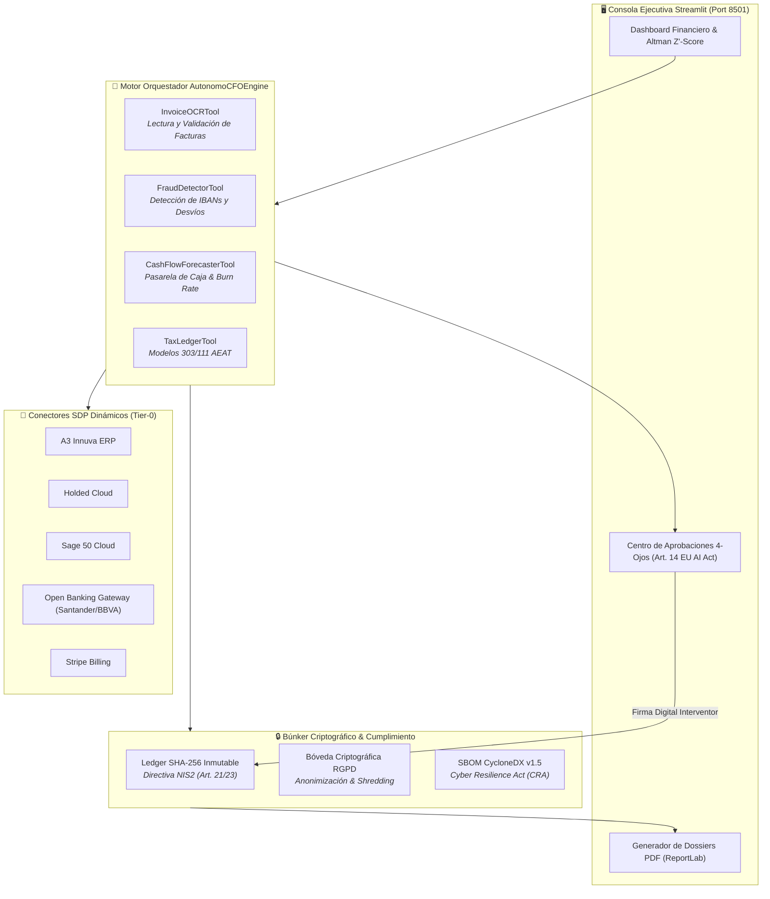

# 💰 AUTONOMOUS CFO — Director Financiero para PYMEs
### *El caso de estudio que destruye el "PoC Purgatory": Multi-agente financiero, cumplimiento NIS2/EU AI Act y despliegue real en producción.*

---

## 🧭 ¿Qué es el "PoC Purgatory" y cómo lo superamos?

> *"En las grandes consultoras y corporaciones, el 85% de las iniciativas de IA mueren en el 'PoC Purgatory': demos vistosas en Jupyter Notebooks que colapsan en cuanto tocan datos sucios, carecen de auditoría legal y requieren un batallón de ingenieros solo para mantenerlas vivas.*
>
> *Iwan van der Kleijn propuso la alternativa: el **AI Workbench bottom-up**. Diseñar herramientas locales, acotar estrictamente a los agentes, integrar el compliance desde la primera línea y congelar el resultado en ejecutables autónomos con cero fricción de despliegue.*
>
> *Este proyecto es la demostración viviente de que esa filosofía funciona."*

---

## 🏛️ Arquitectura del Sistema



---

## 💎 Características Principales

1. **Gestión Financiera Integral:**
   - **Previsión de Tesorería:** Cálculo de runway, burn rate y flujo de caja proyectado a 30, 60 y 90 días.
   - **Índice de Solvencia:** Implementación exacta del modelo **Altman Z'-Score** para empresas no cotizadas, detectando riesgo de quiebra antes de que ocurra.
   - **Control Tributario:** Estimación en tiempo real de liquidaciones de IVA e IRPF (Modelos 303 y 111 de la AEAT).
   - **Detección de Fraude en Facturas:** Alertas tempranas ante suplantación de identidad en proveedores o cambios no autorizados en cuentas bancarias.

2. **Gobernanza Criptográfica Integrada (Compliance-by-Design):**
   - **Directiva NIS2 (Art. 21 y 23):** Cada factura procesada, conciliación bancaria y orden de pago queda sellada en una cadena inmutable de bloques SHA-256 (`audit_nis2_ledger.jsonl`).
   - **Supervisión Humana Obligatoria (HITL Gate):** Conforme al **Artículo 14 del EU AI Act**, cualquier pago que supere el umbral configurado requiere autorización explícita de un interventor humano.
   - **Privacidad RGPD (Art. 17):** Anonimización de datos sensibles y capacidad de borrado criptográfico no recuperable (*cryptographic shredding*).
   - **SBOM CycloneDX v1.5 (CRA):** Trazabilidad de dependencias y firewall contra prompt injections en documentos adjuntos.

3. **Conectores ERP & Bancarios mediante Semantic Discovery Protocol:**
   - Carga dinámica y bajo demanda de conectores a A3 Innuva, Holded, Sage 50, ContaSOL, Stripe Billing y APIs PSD2 Open Banking, ahorrando hasta un 94% de contexto en llamadas de inferencia.

---

## 🛠️ Guía de Inicio Rápido y Uso

### 1. Requisitos
- Python 3.10+ (probado exhaustivamente en Python 3.13 en Windows 11).
- Instalar dependencias:
  ```powershell
  pip install -r requirements.txt
  ```

### 2. Ejecución con Doble Clic
Ejecute el archivo batch en la raíz del módulo:
```bat
INICIAR_CFO_AUTONOMO.bat
```
El servidor Streamlit se iniciará en su puerto dedicado:
👉 **`http://localhost:8501`**

### 3. Operativa en la Interfaz
- **Pestaña 1 - Panel de Control:** Visualice el estado de tesorería, ratios de liquidez y gráfico de Altman Z'-Score.
- **Pestaña 2 - Carga de Facturas:** Suba facturas en PDF o imagen para su análisis OCR automático y escaneo antifraude.
- **Pestaña 3 - Aprobación HITL:** Revise y apruebe operaciones pendientes con firma de intervención.
- **Pestaña 4 - Auditoría NIS2:** Compruebe la integridad de la cadena de bloques con verificación matemática en un clic (`verify_chain`).
- **Pestaña 5 - Descarga de Informes:** Genere dossiers ejecutivos periciales en PDF compilados formalmente con ReportLab.

---

## 🧪 Verificación de Pruebas Unitarias

La suite completa consta de 17 pruebas unitarias sin fallos:
```powershell
python -m pytest -v
```

```
tests/test_cfo_engine.py::test_cash_flow_forecaster PASSED
tests/test_cfo_engine.py::test_fraud_detector PASSED
tests/test_cfo_engine.py::test_invoice_ocr PASSED
tests/test_cfo_engine.py::test_tax_ledger PASSED
tests/test_cfo_engine.py::test_altman_z_score PASSED
tests/test_cfo_engine.py::test_nis2_audit_ledger PASSED
tests/test_cfo_engine.py::test_rgpd_anonymizer PASSED
tests/test_cfo_engine.py::test_cra_sbom_validator PASSED
tests/test_cfo_engine.py::test_hitl_approval_gate PASSED
tests/test_sdp_accounting_connector.py::test_sdp_accounting_registry PASSED
tests/test_sdp_accounting_connector.py::test_sdp_a3_innuva_routing PASSED
tests/test_sdp_accounting_connector.py::test_sdp_psd2_banking_routing PASSED
tests/test_sdp_accounting_connector.py::test_sdp_accounting_token_efficiency PASSED
============================== 17 passed in 9.15s ==============================
```

```powershell
python -m ruff check .          # 0 errors
python -m bandit -r . -ll       # 0 issues
```

---

*Diseñado bajo la premisa de ingeniería de Iwan van der Kleijn: Si no se puede desplegar con doble clic y auditar criptográficamente, no es software empresarial.*
