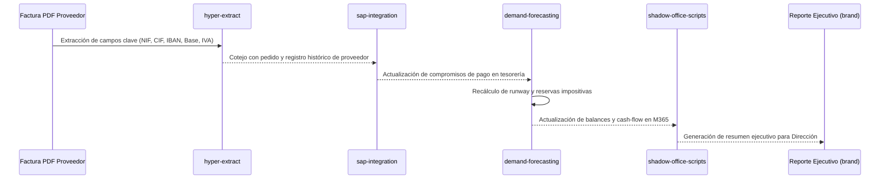

# SKILLS_REGISTRY.md — CFO AUTÓNOMO PARA PYMES
## Catálogo de Skills Especializadas y Protocolos Operativos

> **Sistema:** CFO Director Financiero Autónomo para PYMEs (:8501) 
> **Ámbito:** Inteligencia financiera, conciliación bancaria, modelos predictivos y compliance fiscal 

---

## 1. Mapeo de Skills Especializadas

| Skill | Categoría | Propósito en el Búnker CFO | Gatillo / Contexto de Uso |
| :--- | :--- | :--- | :--- |
| **`demand-forecasting`** | Análisis Predictivo | Modelización de series temporales de ingresos y pagos futuros, cálculo dinámico de *runway* y cobertura de circulante. | Proyección mensual de tesorería, planificación fiscal trimestral. |
| **`sap-integration`** | ERP Financiero | Consulta y conciliación de pedidos, partidas abiertas de proveedores y asientos contables en SAP. | Sincronización con ERP corporativo o importación masiva de asientos. |
| **`shadow-office-scripts`** | Automatización Office | Generación y actualización desatendida de modelos financieros complejos en Excel M365 (Office Scripts TypeScript). | Exportación de informes para Junta Directiva y bancos. |
| **`hyper-extract`** | Ingesta Documental | OCR estructurado y parseo de facturas PDF, tiques y contratos a modelos Pydantic validados. | Recepción de nuevas facturas de proveedores o extractos bancarios. |
| **`brand`** | Comunicación Ejecutiva | Formato visual y tono editorial institucional de nivel C-Suite para reportes a inversores. | Generación del informe de situación financiera mensual. |
| **`code-doctor`** | Fiabilidad de Código | Verificación de 0 fallos de tipado o vulnerabilidades en las herramientas matemáticas financieras. | CI/CD y despliegue de nuevos módulos contables. |
| **`paddleocr`** | Visión Documental | Extracción de tablas de facturas complejas y balances escaneados en local sin enviar datos a APIs externas. | Ingesta de tiques y facturas físicas escaneadas. |
| **`ppt-master`** | Reportes C-Suite | Generación automatizada de presentaciones ejecutivas en `.pptx` con KPIs de solvencia y Altman Z'-score. | Preparación de comités de dirección y bancos. |

---

## 2. Flujo Operativo de Facturación y Tesorería

