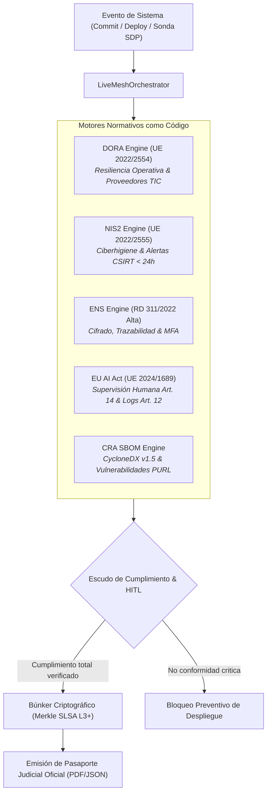

# MANUAL DE USO Y OPERACIÓN — COMPLIANCE-AS-CODE LIVE MESH
### *Guía de Operación para Auditores de Ciberseguridad y Oficiales de Cumplimiento*

---

## 1. Visión y Funcionamiento del Tejido Vivo

El **Compliance-as-Code Live Mesh** sustituye las auditorías anuales estáticas basadas en hojas de cálculo por una verificación matemática continua en tiempo de ejecución:



---

## 2. Puesta en Marcha

### Modo 1: Lanzador de Un Clic
Doble clic sobre el script de inicio:
```bat
INICIAR_COMPLIANCE_LIVE_MESH.bat
```
La consola Streamlit se abrirá en el puerto dedicado:
 **`http://localhost:8507`**

### Modo 2: Validación Automatizada
Para comprobar los 19 tests unitarios del Live Mesh:
```powershell
python -m pytest tests -v
```

---

## 3. Guía de Operación por Pestañas

### Pestaña 1: Dashboard Ejecutivo de Cumplimiento
- Visión general del índice de cumplimiento ponderado global (0% a 100%).
- Desglose por marco normativo: DORA, NIS2, ENS, EU AI Act y CRA.
- Estado de los bloqueos preventivos activos.

### Pestaña 2: Evaluación Detallada por Normativa
- **DORA:** Inspecciona redundancia TIC, pruebas de penetración y acuerdos de nivel de servicio con proveedores tecnológicos.
- **NIS2:** Verifica que las políticas de copias de seguridad aisladas (*air-gapped*) y los canales de notificación al CSIRT respondan en menos de 24 horas.
- **ENS (Categoría Alta):** Comprueba segregación de entornos, registro exhaustivo de actividad administrativa y cifrado robusto.
- **EU AI Act:** Valida los registros inmutables requeridos por el Art. 12 y la existencia de una pasarela de intervención humana (Art. 14).
- **CRA (CycloneDX):** Analiza el archivo SBOM de componentes de software para detectar dependencias vulnerables o desactualizadas.

### Pestaña 3:  Escudo Regulatorio & HITL
- Permite a los CISO y arquitectos autorizados revisar incidentes bloqueados y emitir firmas de excepción temporal con justificación pericial.

### Pestaña 4: Búnker Criptográfico y Pasaportes
- Generación de pasaportes oficiales en formato PDF compilados formalmente con ReportLab.
- Verificación del árbol de Merkle y hashes SHA-256 no repudiables.

---

## 4. Skills y Servidores MCP Utilizados

Consulte los detalles técnicos en:
- [AGENTS.md](./AGENTS.md): Gobernanza del Consejo de Jueces (`DORALeadJudge`, `NIS2CybersecurityJudge`, etc.).
- [SKILLS_REGISTRY.md](./SKILLS_REGISTRY.md): Catálogo de skills (`cybersec-assessment`, `gdpr-compliance`, `hyper-extract`, etc.).
- [MCP_INTEGRATION.md](./MCP_INTEGRATION.md): Integración con `postgres-mcp-server`, `aws-mcp`, `github-mcp-server` y `scrapling-mcp`.
