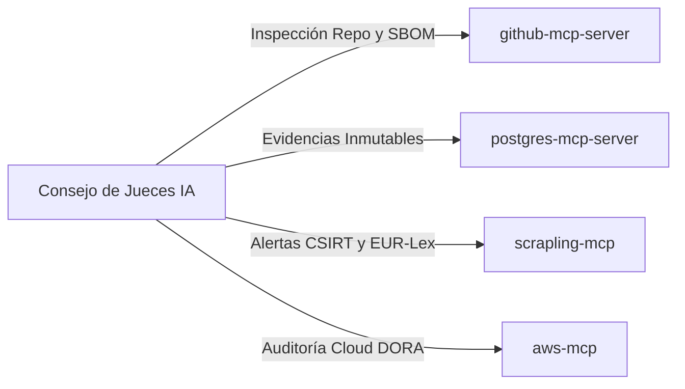

# 🔌 MCP_INTEGRATION.md — COMPLIANCE-AS-CODE LIVE MESH
## Integración de Servidores Model Context Protocol (Zero-Docker Native)

> **Directiva Mandatoria:** Cero dependencias de contenedores Docker. Todos los servidores se ejecutan nativamente en el host mediante `npx` (Node.js) o `uvx` (Python).

---

## 1. Servidores MCP Asignados

| Servidor MCP | Runtime / Transporte | Propósito Operativo |
| :--- | :--- | :--- |
| **`postgres-mcp-server`** | `npx -y @modelcontextprotocol/server-postgres` (`stdio`) | Persistencia inmutable del Merkle Tree de auditoría, logs regulatorios y pasaportes de cumplimiento. |
| **`github-mcp-server`** | `npx -y @modelcontextprotocol/server-github` (`stdio`) | Inspección de repositorios, auditoría de commits, validación de SBOM CycloneDX y branch protection rules. |
| **`aws-mcp`** | `uvx aws-mcp` / local (`stdio`) | Verificación de políticas IAM, cifrado KMS en reposo, versionado S3 y retención CloudTrail para NIS2/DORA. |
| **`scrapling-mcp`** | `uvx scrapling-mcp` (`stdio`) | Scraping en tiempo real de boletines oficiales de ciberseguridad (INCIBE CSIRT, CISA KEV, EUR-Lex). |

---

## 2. Configuración Nativa de Referencia (`mcp_config.json`)

```json
{
  "mcpServers": {
    "postgres": {
      "command": "npx",
      "args": ["-y", "@modelcontextprotocol/server-postgres", "${POSTGRES_COMPLIANCE_URI}"]
    },
    "github": {
      "command": "npx",
      "args": ["-y", "@modelcontextprotocol/server-github"],
      "env": {
        "GITHUB_PERSONAL_ACCESS_TOKEN": "${GITHUB_TOKEN}"
      }
    },
    "scrapling": {
      "command": "uvx",
      "args": ["scrapling-mcp"]
    }
  }
}
```

---

## 3. Matriz de Auditoría y Verificación de Herramientas


