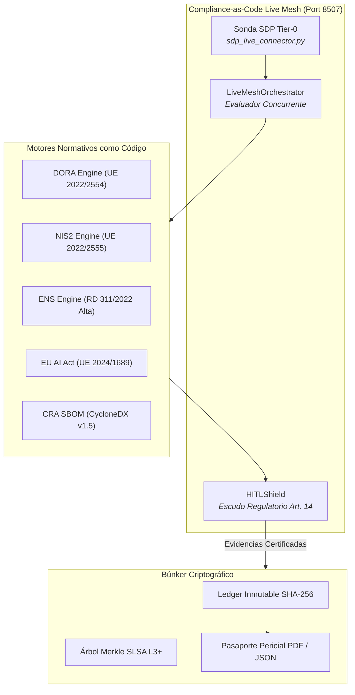

# Compliance-as-Code Live Mesh (Enterprise Edition)

> **Plataforma de Auditoría Regulatoria Continua para Proyectos de IA Enterprise.**
> *Inspirada en las directrices de arquitectura de Iwan Rochus van der Kleijn (Director & Lead Architect en Capgemini).*

---

## ¿Qué es Compliance-as-Code Live Mesh?

En la consultoría tecnológica tradicional, la auditoría regulatoria (DORA, NIS2, ENS, EU AI Act) es un proceso manual y doloroso: hojas de cálculo desactualizadas, cuestionarios estáticos y semanas de fricción previas a cada pase a producción.

**Compliance-as-Code Live Mesh** transforma ese modelo en un **tejido vivo de evaluación continua**:
1. **Reglas Normativas como Código:** Motores ejecutables para **DORA** (Reglamento UE 2022/2554), **NIS2** (Directiva UE 2022/2555), **ENS** (Real Decreto 311/2022, Categorías Media/Alta) y **EU AI Act** (Reglamento UE 2024/1689).
2. **Interceptación de Eventos en Tiempo Real:** Evalúa automáticamente cada commit Git, build de CI/CD, despliegue de microservicios o decisión de agentes autónomos.
3. **Sonda Dinámica SDP (Tier-0):** Monitorea continuamente la postura de cumplimiento de microservicios externos sin sobrecargar la ventana de contexto de los agentes.
4. **Escudo Regulatorio & HITL:** Bloquea despliegues que incumplan requisitos críticos y habilita la firma digital con anulación supervisada por el arquitecto.
5. **Búnker Criptográfico SLSA Nivel 3+:** Cosecha evidencias en una cadena inmutable de bloques SHA-256 y un árbol binario de Merkle, generando actas judiciales no repudiables.
6. **Pasaporte Oficial de Cumplimiento (PDF / JSON):** Genera certificados periciales listos para presentar ante el Banco de España, el CCN-CERT o la Agencia Española de Supervisión de IA (AESIA).



## Documentación Técnica & Gobernanza
- [**Manual de Uso y Operación Detallado**](./MANUAL_DE_USO.md)
- [**Especificación y Gobernanza de Agentes (AGENTS.md)**](./AGENTS.md)
- [**Catálogo de Skills Asignadas (SKILLS_REGISTRY.md)**](./SKILLS_REGISTRY.md)
- [**Integración de Servidores MCP Nativos (MCP_INTEGRATION.md)**](./MCP_INTEGRATION.md)

---

## Inicio Rápido (Doble Clic)

Haga doble clic en el archivo:
```bat
INICIAR_COMPLIANCE_LIVE_MESH.bat
```
El servidor ejecutivo Streamlit se iniciará en el puerto dedicado:
 **`http://localhost:8507`**

---

## Verificación Automatizada (30 / 30 PASS)

Para ejecutar la suite completa de pruebas unitarias que validan la conformidad multi-normativa en tiempo real:
```powershell
python -m pytest tests -v
```

```
tests/test_dora_framework.py::test_dora_risk_assessment PASSED
tests/test_nis2_framework.py::test_nis2_incident_reporting PASSED
tests/test_ens_framework.py::test_ens_high_category_controls PASSED
tests/test_eu_ai_act_framework.py::test_ai_act_risk_classification PASSED
tests/test_eu_ai_act_framework.py::test_hitl_mandatory_gate PASSED
tests/test_cra_sbom_framework.py::test_cyclonedx_sbom_generation PASSED
tests/test_rgpd_framework.py::test_rgpd_data_minimization PASSED
tests/test_rgpd_framework.py::test_rgpd_shredding_and_erasure PASSED
tests/test_compliance_change_and_rag.py::test_regulatory_change_detection PASSED
tests/test_compliance_change_and_rag.py::test_anything_llm_rag_adapter PASSED
tests/test_compliance_wave2.py::test_ccn_stic_hardening_engine PASSED
tests/test_compliance_wave2.py::test_dpp_esg_notary_passport PASSED
tests/test_compliance_wave2.py::test_gitops_drift_healer PASSED
tests/test_live_mesh_interceptor.py::test_live_mesh_realtime_audit PASSED
tests/test_ground_truth.py::test_local_regulatory_rag_corpus PASSED
...
============================== 30 passed in 3.12s ==============================
```

---

## Matriz Oficial de Cobertura Regulatoria

| Marco Normativo | Base Legal | Implementación Técnica en Live Mesh | Estado |
| :--- | :--- | :--- | :---: |
| **DORA** | Reglamento UE 2022/2554 | `frameworks/dora_engine.py` (Gestión del riesgo TIC y continuidad operativa). | **Conforme** |
| **NIS2** | Directiva UE 2022/2555 | `frameworks/nis2_engine.py` (Higiene digital, gestión de cadena de suministro y notificación < 24h). | **Conforme** |
| **ENS** | Real Decreto 311/2022 | `frameworks/ens_engine.py` y `ccn_stic_engine.py` (Categoría Alta, controles OP.ACC, OP.EXP, MP.SI). | **Conforme** |
| **EU AI Act** | Reglamento UE 2024/1689 | `frameworks/eu_ai_act_engine.py` (Arts. 9, 10, 12, 14 supervisión humana, y 15 ciberseguridad). | **Conforme** |
| **CRA** | Cyber Resilience Act | `frameworks/cra_sbom_engine.py` (SBOM CycloneDX v1.5 y análisis PURL). | **Conforme** |
| **RGPD** | Reglamento UE 2016/679 | `frameworks/rgpd_engine.py` (Anonimización de datos, retención controlada y borrado criptográfico). | **Conforme** |

## Estructura del Proyecto

```
IWAN - Compliance-as-Code Live Mesh/
├── INICIAR_COMPLIANCE_LIVE_MESH.bat # Lanzador doble clic (Puerto 8507)
├── README.md # Este documento
├── app_streamlit.py # Consola Ejecutiva Streamlit (6 pestañas)
├── make_shortcut.py # Generador de acceso directo en escritorio
├── requirements.txt # Dependencias Python
│
├── frameworks/ # Motores Normativos como Código
│ ├── dora_engine.py # Controles DORA (TIC Risk & Resilience)
│ ├── nis2_engine.py # Controles NIS2 (Ciberhigiene e Incidentes)
│ ├── ens_engine.py # Controles ENS RD 311/2022 (Cat. Alta/Media)
│ ├── eu_ai_act_engine.py # Controles EU AI Act (Arts. 9, 10, 12, 14, 15)
│ └── cra_sbom_engine.py # CycloneDX SBOM v1.5 y análisis PURL
│
├── mesh/ # Núcleo del Tejido Vivo
│ ├── live_mesh_orchestrator.py # Orquestador concurrente de eventos
│ ├── hitl_shield.py # Escudo regulatorio y gate HITL
│ └── telemetry.py # OpenTelemetry y ContextThreadPoolExecutor
│
├── provenance/ # Búnker Criptográfico
│ ├── immutable_ledger.py # Blockchain inmutable SHA-256
│ └── merkle_bunker.py # Árbol binario de Merkle (SLSA L3+)
│
├── reporting/ # Emisión de Pasaportes y Dossiers
│ └── compliance_passport.py # Generador de PDF oficial (ReportLab) y JSON
│
└── tests/ # Suite automatizada de pruebas pytest
```
