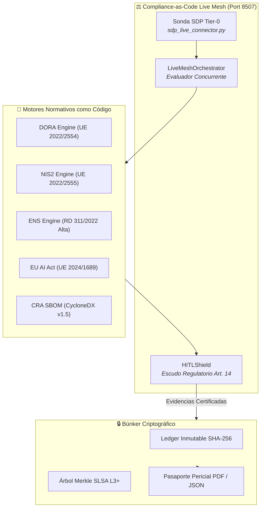

# ⚖️ IWAN - Compliance-as-Code Live Mesh (Enterprise Edition)

> **Plataforma de Auditoría Regulatoria Continua para Proyectos Enterprise en Capgemini.**
> Diseñada para: **Iwan Rochus van der Kleijn (Director & Lead Architect en Capgemini).**

---

## 🎯 ¿Qué es Compliance-as-Code Live Mesh?

En la consultoría tecnológica tradicional, la auditoría regulatoria (DORA, NIS2, ENS, EU AI Act) es un proceso manual y doloroso: hojas de cálculo desactualizadas, cuestionarios estáticos y semanas de fricción previas a cada pase a producción.

**Compliance-as-Code Live Mesh** transforma ese modelo en un **tejido vivo de evaluación continua**:
1. **Reglas Normativas como Código:** Motores ejecutables para **DORA** (Reglamento UE 2022/2554), **NIS2** (Directiva UE 2022/2555), **ENS** (Real Decreto 311/2022, Categorías Media/Alta) y **EU AI Act** (Reglamento UE 2024/1689).
2. **Interceptación de Eventos en Tiempo Real:** Evalúa automáticamente cada commit Git, build de CI/CD, despliegue de microservicios o decisión de agentes autónomos.
3. **Sonda Dinámica SDP (Tier-0):** Monitorea continuamente la postura de cumplimiento de microservicios externos sin sobrecargar la ventana de contexto de los agentes.
4. **Escudo Regulatorio & HITL:** Bloquea despliegues que incumplan requisitos críticos y habilita la firma digital con anulación supervisada por el arquitecto.
5. **Búnker Criptográfico SLSA Nivel 3+:** Cosecha evidencias en una cadena inmutable de bloques SHA-256 y un árbol binario de Merkle, generando actas judiciales no repudiables.
6. **Pasaporte Oficial de Cumplimiento (PDF / JSON):** Genera certificados periciales listos para presentar ante el Banco de España, el CCN-CERT o la Agencia Española de Supervisión de IA (AESIA).



---

## 🚀 Inicio Rápido (Doble Clic)

Haga doble clic en el archivo:
```bat
INICIAR_COMPLIANCE_LIVE_MESH.bat
```
El servidor ejecutivo Streamlit se iniciará en el puerto dedicado:
👉 **`http://localhost:8507`**

---

## 🧪 Verificación Automatizada

Para ejecutar la suite completa de pruebas unitarias:
```powershell
python -m pytest tests -v
```

---

## 🏛️ Estructura del Proyecto

```
IWAN - Compliance-as-Code Live Mesh/
├── INICIAR_COMPLIANCE_LIVE_MESH.bat   # Lanzador doble clic (Puerto 8507)
├── README.md                          # Este documento
├── app_streamlit.py                   # Consola Ejecutiva Streamlit (6 pestañas)
├── make_shortcut.py                   # Generador de acceso directo en escritorio
├── requirements.txt                   # Dependencias Python
│
├── frameworks/                        # Motores Normativos como Código
│   ├── dora_engine.py                 # Controles DORA (TIC Risk & Resilience)
│   ├── nis2_engine.py                 # Controles NIS2 (Ciberhigiene e Incidentes)
│   ├── ens_engine.py                  # Controles ENS RD 311/2022 (Cat. Alta/Media)
│   ├── eu_ai_act_engine.py            # Controles EU AI Act (Arts. 9, 10, 12, 14, 15)
│   └── cra_sbom_engine.py             # CycloneDX SBOM v1.5 y análisis PURL
│
├── mesh/                              # Núcleo del Tejido Vivo
│   ├── live_mesh_orchestrator.py      # Orquestador concurrente de eventos
│   ├── hitl_shield.py                 # Escudo regulatorio y gate HITL
│   └── telemetry.py                   # OpenTelemetry y ContextThreadPoolExecutor
│
├── provenance/                        # Búnker Criptográfico
│   ├── immutable_ledger.py            # Blockchain inmutable SHA-256
│   └── merkle_bunker.py               # Árbol binario de Merkle (SLSA L3+)
│
├── reporting/                         # Emisión de Pasaportes y Dossiers
│   └── compliance_passport.py         # Generador de PDF oficial (ReportLab) y JSON
│
└── tests/                             # Suite automatizada de pruebas pytest
```
