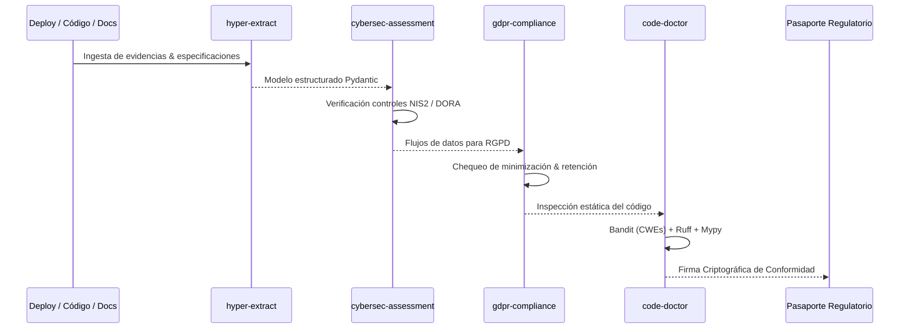

# SKILLS_REGISTRY.md — COMPLIANCE-AS-CODE LIVE MESH
## Catálogo de Skills Especializadas y Protocolos de Verificación

> **Sistema:** Compliance-as-Code Live Mesh (:8507) 
> **Alcance:** Auditoría automatizada, extracción normativa e inspección regulatoria 

---

## 1. Mapeo de Skills por Dimensión Regulatoria

| Skill | Categoría | Propósito en Compliance Mesh | Gatillo / Contexto de Uso |
| :--- | :--- | :--- | :--- |
| **`cybersec-assessment`** | Ciberseguridad | Evaluación de postura de seguridad, auditoría de WAF, IAM, OWASP Top 10 y preparación NIS2/DORA. | Análisis de arquitectura de red, revisión de configuraciones de seguridad. |
| **`gdpr-compliance`** | Privacidad | Verificación de cumplimiento RGPD/GDPR: cookies, retención de datos, consentimiento y privacy-by-design. | Detección de flujos de datos personales, revisión de contratos y formularios. |
| **`lca-carbon-footprint`** | Sostenibilidad / ESG | Cálculo de huella de carbono y generación de Pasaportes Digitales de Producto (DPP) según directivas UE. | Auditoría de sostenibilidad en cadena de suministro y huella de cómputo. |
| **`echa-compliance`** | Cumplimiento Químico | Consulta de normativas REACH y listas de sustancias altamente preocupantes (SVHC). | Validación de fichas de seguridad y listas de materiales. |
| **`hyper-extract`** | Ingesta Estructurada | Extracción de normativa legal (BOE, DOUE, directivas UE en PDF) a modelos Pydantic y Grafos de Regulación. | Carga de nuevos marcos legales o actualización de normativas. |
| **`code-doctor`** | Auditoría Estática | Verificación de 0 vulnerabilidades (Bandit) y conformidad de tipos y estilo antes de emitir dictamen. | CI/CD y análisis previo a cualquier emisión de certificado de cumplimiento. |
| **`changedetection`** | Vigilancia Regulatoria | Escaneo continuo de BOE, DOUE y EUR-Lex para detectar enmiendas a DORA/NIS2/EU AI Act y lanzar re-auditorías automáticas. | Recepción de webhooks con diffs normativos. |
| **`anything-llm`** | Ground Truth Privado | Consulta a colecciones RAG locales aisladas por marco normativo sin alucinaciones ni fuga de datos. | Verificación de artículos citados en dictámenes judiciales. |

---

## 2. Flujo de Ejecución Orquestado por Skills

---

## 3. Protocolo de Ejecución Agnóstico

1. **Determinismo Normativo:** Ningún LLM debe "opinar" sobre una ley sin antes anclar su razonamiento al artículo y párrafo exacto extraído por `hyper-extract`.
2. **Evidencia Previa a la Aserción:** Una regla de compliance se considera aprobada únicamente si existe un artefacto auditable (log, test, hash o diff) que lo demuestre.
3. **Escalamiento Inmediato:** Violaciones de Severidad Crítica (ej. credenciales en código, ausencia de MFA en roles admin) generan una alerta inmediata al Oficial de Cumplimiento.
