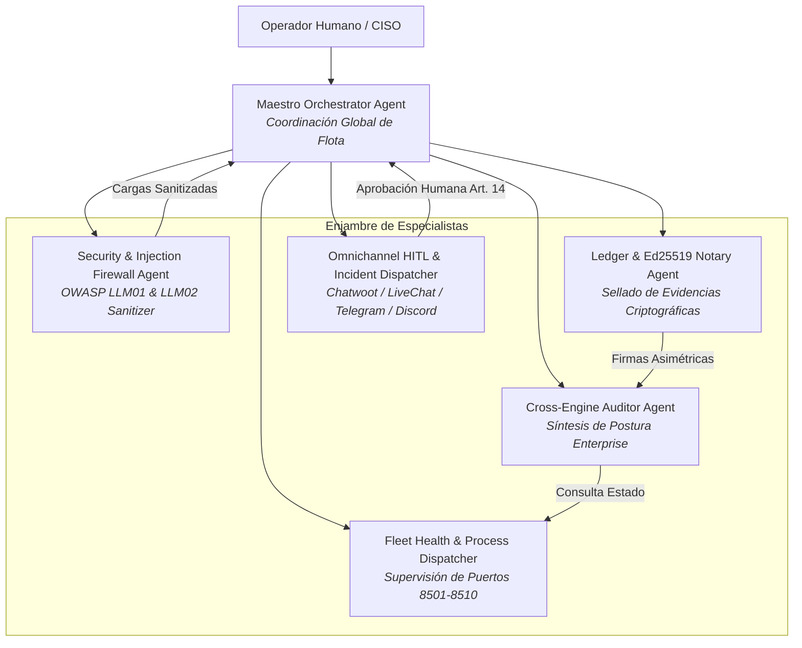

# 👑 AGENTS.md — QGRADE_OS The Maestro Cockpit
## Especificación y Gobernanza de Agentes del Hipervisor Central

> **Ámbito de Aplicación:** Centro de Mando Orquestador (Puerto 8500).  
> **Arquitectura:** Agnóstica al modelo de lenguaje (compatible con Anthropic Claude, Google Gemini, OpenAI, DeepSeek y despliegues locales vLLM/Ollama).  
> **Filosofía:** Gobernanza descentralizada, verificación formal de contratos y cero dependencia de Docker.

---

## 1. Topología del Enjambre de Agentes

---

## 2. Roles y Perfiles de Agente

### A. Maestro Orchestrator Agent
- **Misión:** Coordinar la flota de los 8 microservicios, interpretar las directivas del operador y consolidar las respuestas del enjambre.
- **Protocolo de Razonamiento:** Identificar intención → verificar precondiciones → despachar en paralelo → sintetizar con evidencia empírica.

### B. Security & Injection Firewall Agent
- **Misión:** Sanitización profunda contra indirect prompt injection (OWASP LLM01) y fuga de credenciales.
- **Invariantes:** Bloqueo de patrones de escape. Redacción automática a `[REDACTED_ADVERSARIAL_INJECTION]`.

### C. Cross-Engine Auditor Agent
- **Misión:** Diagnósticos multidimensionales agregando White Coding, Compliance y economía de tokens SDP.
- **Invariantes:** Ninguna afirmación de cumplimiento válida sin hash criptográfico verificable.

### D. Ledger & Ed25519 Notary Agent
- **Misión:** Administrar par de claves Ed25519 y sellar cada dictamen en el árbol de Merkle append-only.
- **Invariantes:** Verificación matemática en tiempo constante. Firma de 64 bytes inmutable por bloque.

### E. Omnichannel HITL & Incident Dispatcher Agent
- **Misión:** Transmitir alertas urgentes y solicitudes de aprobación humana (Art. 14 EU AI Act) a canales omnicanal.
- **Skills:** `chatwoot`, `livechat`, `agent-reach`
- **Invariantes:** Despacho inmediato ante riesgo crítico. Bloqueo hasta firma digital del operador. Registro auditable.

---

## 3. Puertas de Supervisión Humana (HITL Gate - Art. 14 EU AI Act)

Ningún agente puede ejecutar autónomamente:
1. Reinicio forzado de servicios en producción.
2. Rotación o exportación de claves privadas Ed25519.
3. Alteración de umbrales de riesgo en auditorías de cumplimiento.

*Cualquier intento genera evento firmado por `OmnichannelHITLBridge` requiriendo autorización explícita del operador.*
