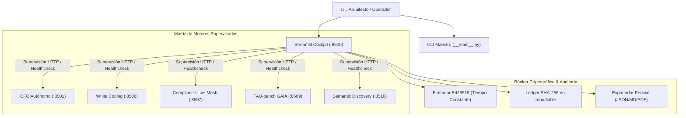

# 📖 MANUAL DE USO Y OPERACIÓN — QGRADE_OS MAESTRO COCKPIT
### *Guía Táctica de Operación para el Ingeniero y Director de Arquitectura*

---

## 1. Visión y Propósito Operativo

**QGRADE_OS — The Maestro Cockpit** es la torre de control y el hipervisor unificado del ecosistema Quantigrade. Diseñado bajo el principio de *arquitectura bottom-up*, no requiere infraestructura pesada de nube ni contenedores opacos para su puesta en marcha: se opera de forma local, determinista y auditable.



---

## 2. Puesta en Marcha

### Modo 1: Lanzador de Un Clic (Recomendado en Windows)
Haga doble clic sobre el script ubicado en la raíz del proyecto:
```bat
INICIAR_QUANTIGRADE_MAESTRO.bat
```
El script comprobará el entorno virtual Python, validará las dependencias y abrirá el navegador en:
👉 **`http://localhost:8500`**

### Modo 2: Consola Interactiva (CLI)
Para operadores de terminal o entornos headless:
```bat
INICIAR_MAESTRO_CLI.bat
```
O directamente con Python:
```powershell
python -m orchestrator
```

---

## 3. Guía Paso a Paso de las Pestañas del Cockpit

### Pestaña 1: 🚀 Fleet Status & Process Launcher
- **Monitor de Puertos:** Observa el estado en tiempo real (activo/inactivo) de los puertos `8500` a `8510`.
- **Botón `Launch Fleet`:** Inicia en segundo plano las consolas independientes de cada microservicio sin bloquear la UI principal.
- **Healthcheck Dinámico:** Verifica que cada microservicio responda con código HTTP `200` y exponga su esquema de telemetría.

### Pestaña 2: 🛡️ Dual-Model Firewall & Guards (OWASP LLM01)
- **Probador de Prompts:** Inyecte payloads de prueba (jailbreaks, instrucciones indirectas, fugas de system prompt).
- **Inspección de Sanitización:** El firewall enruta la entrada a través de un evaluador rápido que censura o neutraliza comandos antes de que alcancen a los agentes.
- **MicroVM Process Guard:** Demostración de intercepción de comandos destructivos (`rm -rf`, `drop table`, `format c:`).

### Pestaña 3: ⚖️ Cross-Engine Peritaje Unificado
- Ejecuta un peritaje simultáneo que recolecta:
  - Veredicto de solvencia del CFO (Altman Z'-Score).
  - Estado de contratos congelados de White Coding Harness.
  - Dictamen regulatorio de Compliance Live Mesh (DORA, NIS2, ENS, EU AI Act).
  - Puntuación EARS de resiliencia de TAU-bench.
  - Ahorro de tokens obtenido por Semantic Discovery Protocol.

### Pestaña 4: 🔐 Criptografía Ed25519 & Árbol Merkle
- **Generación de Claves:** Genera o regenera pares asimétricos Ed25519.
- **Firma de Bloques:** Firma digitalmente el último estado del libro mayor.
- **Verificación Criptográfica:** Comprueba en tiempo constante que ningún registro histórico haya sido alterado localmente.

### Pestaña 5: 📄 Exportador Pericial Universal
- Emite con un solo clic el **Dossier Ejecutivo de Certificación** en formatos:
  - `JSON`: Estructurado para ingesta en SIEM o auditorías automatizadas.
  - `Markdown`: Formato legible por humanos y versionable en Git.
  - `PDF`: Documento formal corporativo con membrete Quantigrade y hash de validez probatoria.

---

## 4. Skills y Servidores MCP Utilizados

Consulte los detalles técnicos en:
- [AGENTS.md](./AGENTS.md): Gobernanza de roles (`MaestroSwarmOrchestrator`, `DualModelDualFirewall`, etc.).
- [SKILLS_REGISTRY.md](./SKILLS_REGISTRY.md): Catálogo de skills (`swarms`, `litellm`, `cubesandbox`, `code-doctor`, etc.).
- [MCP_INTEGRATION.md](./MCP_INTEGRATION.md): Configuración nativa zero-docker de `slack-mcp-server`, `github-mcp-server`, `n8n-mcp` y `postgres-mcp-server`.
