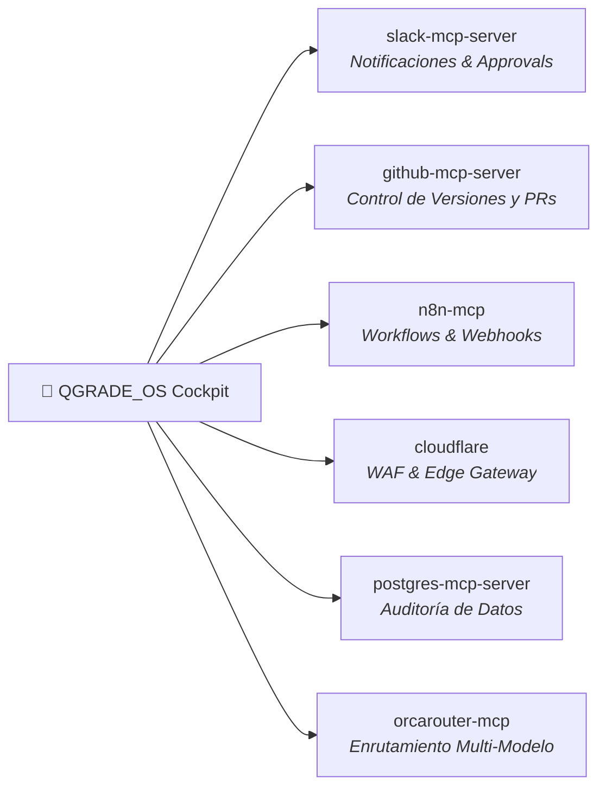

# 🔌 MCP_INTEGRATION.md — QGRADE_OS The Maestro Cockpit
## Integración de Servidores Model Context Protocol Nativos (Zero Docker)

> **Estándar:** Model Context Protocol (Anthropic/Open-Source)  
> **Directiva Mandatoria:** 100% Nativo sin Docker. Transporte mediante `stdio` local (`npx`, `uvx`) o URLs remotas `SSE`.

---

## 1. Servidores MCP Asignados a QGRADE_OS



---

## 2. Configuración Nativa para `mcp_config.json`

```json
{
  "mcpServers": {
    "slack-mcp-server": {
      "command": "npx",
      "args": ["-y", "@modelcontextprotocol/server-slack"],
      "env": { "SLACK_BOT_TOKEN": "xoxb-YOUR_TOKEN", "SLACK_TEAM_ID": "T_YOUR_ID" }
    },
    "github-mcp-server": {
      "command": "npx",
      "args": ["-y", "@modelcontextprotocol/server-github"],
      "env": { "GITHUB_PERSONAL_ACCESS_TOKEN": "YOUR_GITHUB_TOKEN" }
    },
    "n8n-mcp": {
      "command": "npx",
      "args": ["-y", "n8n-mcp"],
      "env": { "N8N_API_URL": "http://localhost:5678", "N8N_API_KEY": "YOUR_N8N_KEY" }
    },
    "cloudflare": { "url": "https://mcp.cloudflare.com/mcp" },
    "orcarouter-mcp": {
      "command": "npx",
      "args": ["-y", "orcarouter-mcp-server"],
      "env": { "ORCA_DEFAULT_PRIORITY": "balanced" }
    }
  }
}
```

---

## 3. Catálogo de Herramientas Expuestas

| Servidor MCP | Herramienta | Propósito en el Cockpit |
| :--- | :--- | :--- |
| `slack-mcp-server` | `post_message` | Alertas críticas de caída de servicio a ingenieros de guardia. |
| `github-mcp-server` | `create_issue` | Tickets automáticos ante violaciones de cumplimiento persistentes. |
| `n8n-mcp` | `search_templates` | Descubrimiento de recetas de automatización para flujos de remediación. |
| `cloudflare` | `dns_list_records` | Verificación de resolución de nombres y salud de certificados TLS. |
| `orcarouter-mcp` | `route_prompt` | Enrutamiento inteligente multi-modelo para optimizar coste y latencia. |
