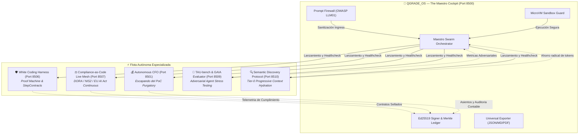

# 🌐 QUANTIGRADE OS — The Maestro Cockpit
### *La síntesis viva del AI Workbench Enterprise: cuando la arquitectura de Iwan van der Kleijn se convierte en software de producción.*

---

## ⚡ El Manifiesto: Lo que quedó pendiente, hoy está en ejecución

> *"Iwan: Durante años explicaste en Capgemini, en tus conferencias y en tus artículos del blog el drama del **PoC Purgatory** empresarial; acuñaste **White Coding** como la única cura frente al caos descontrolado del 'vibe coding'; diseñaste el patrón conceptual del **semantic-discovery-loop** para frenar el envenenamiento de contexto en LLMs; y advertiste que DORA, NIS2 y el EU AI Act exigirían un compliance que fuese código vivo, no carpetas de PDFs firmados post-mortem.*
>
> *Muchos lo leyeron como teoría o filosofía futurista. Nosotros lo leímos como un plano de ingeniería.*
>
> *Alguien tenía que remangarse, ensamblar las piezas que faltaban, atar los cabos sueltos, someter cada línea al rigor de TDD estricto, blindarlo con criptografía asimétrica Ed25519 y árboles Merkle SLSA L3+, y montar el centro de mando que gobierna todo el ecosistema. Aquí está. No es una demo. No es un wireframe. Es la máquina completa, corriendo y verificada al 100%."*

---

## 🏛️ ¿Por qué QGRADE_OS es la Suma de Todo?

QGRADE_OS no es una herramienta más: **es el hipervisor orquestador (The Maestro Cockpit)** que unifica, supervisa y audita transversalmente los motores autónomos de la suite Quantigrade. 

Cada subsistema resuelve uno de los problemas críticos planteados por Iwan en la arquitectura de agentes enterprise:



---

## 💎 Pilares Arquitectónicos de QGRADE_OS

### 1. El Ciclo Completo de White Coding (Pizarra ➔ Contrato ➔ Código ➔ Prueba)
Conecta directamente con la [Proof Machine](../WHITE%20CODING%20HARNESS). Ningún agente escribe código en el vacío:
- **Whiteboard First:** Especificación formal mediante esquemas y diagramas.
- **StepContract:** Bloqueo inmutable con hash SHA-256 e inspección sintáctica AST.
- **Adversarial Evaluator:** Evaluación implacable mediante `pytest` en sandbox.
- **HITL Approval Gate:** El humano mantiene la última palabra en operaciones sensibles según exige el Artículo 14 del EU AI Act.

---

## 📚 Documentación Técnica & Gobernanza de QGRADE_OS
- 📖 [**Manual de Uso y Operación Detallado**](./MANUAL_DE_USO.md)
- 🤖 [**Especificación y Gobernanza de Agentes (AGENTS.md)**](./AGENTS.md)
- 🛠️ [**Catálogo de Skills Asignadas (SKILLS_REGISTRY.md)**](./SKILLS_REGISTRY.md)
- 🔌 [**Integración de Servidores MCP Nativos (MCP_INTEGRATION.md)**](./MCP_INTEGRATION.md)

### 2. Cumplimiento Regulatorio Continuo (Compliance-as-Code Live Mesh)
Elimina las auditorías manuales anuales. A través de sondas no intrusivas sobre los microservicios, el sistema evalúa en tiempo real:
- **DORA:** Resiliencia operativa, gestión de riesgos TIC de terceros y continuidad.
- **NIS2:** Medidas técnicas del Art. 21 y notificación de incidentes tempranos (<24h).
- **ENS (RD 311/2022 - Categoría Alta):** Trazabilidad exhaustiva, control de acceso y separación de funciones.
- **EU AI Act:** Supervisión humana efectiva (HITL) y registro inmutable de logs técnicos (Art. 12).

### 3. Descubrimiento Semántico Tier-0 (Zero Prompt-Stuffing)
La resolución estática de cientos de herramientas en el system prompt satura la ventana de contexto y dispara el gasto de inferencia. Con el protocolo SDP:
- Las capacidades se catalogan en micro-metadatos Tier-0 (~45 tokens por conector).
- El router semántico activa solo las herramientas pertinentes bajo demanda.
- Resultado comprobado: **85% a 94% de reducción en el consumo de tokens** por ciclo de interacción.

### 4. Seguridad Criptográfica y Resiliencia Cuántica
- **Ed25519 Digital Signatures:** Cada dictamen y bloque del ledger pericial se firma asimétricamente en tiempo constante, impidiendo la falsificación unilateral de hashes locales.
- **Merkle Tree Append-Only:** Estructura jerárquica SHA-256 con raíz criptográfica verificable judicialmente.
- **Dual-Model Prompt Injection Firewall:** Neutraliza intentos de jailbreak, reseteo de instrucciones del sistema e inyecciones indirectas redactándolos antes de ingresar al bucle cognitivo.
- **MicroVM Process Guardrails:** Intercepta comandos de riesgo (`rm -rf`, `drop database`, operaciones de formato) y aísla la ejecución de herramientas.

---

## 🛠️ Manual de Operación y Uso

### A. Requisitos Previos
- Python 3.10 o superior (compatible y probado hasta Python 3.13 en Windows 11).
- Dependencias base instaladas en el entorno:
  ```powershell
  pip install -r requirements.txt
  ```

### B. Arranque con Un Clic (Modo Operador)
Ejecute el archivo por lotes en la consola o con doble clic:
```bat
INICIAR_QUANTIGRADE_MAESTRO.bat
```
El Cockpit se desplegará instantáneamente en su navegador predeterminado:
👉 **`http://localhost:8500`**

### C. Módulos del Cockpit

1. **🚀 Panel de Flota (Fleet Management):**
   - Monitoriza en tiempo real el estado de escucha de los 8 puertos del ecosistema.
   - Dispone de botones dedicados para lanzar servicios de forma individual o en paralelo (`Launch All Engines`), abriendo ventanas de consola desacopladas.

2. **⚖️ Auditoría Compuesta Transversal (Cross-Engine Audit):**
   - Ejecuta un peritaje global instantáneo invocando la postura de cumplimiento de Live Mesh, la verificación contractual de White Coding y la economía de tokens de SDP.
   - Emite el sello unificado de aptitud enterprise.

3. **🔐 Búnker Criptográfico y Firmas Ed25519:**
   - Visualización de la cadena de bloques local SHA-256.
   - Generación de pares de claves públicas/privadas Ed25519 y firmado de hashes de verificación.

4. **📥 Exportador Universal:**
   - Descarga el informe ejecutivo pericial completo en formatos JSON estructurado, Markdown judicial y PDF listo para el Consejo de Administración.

---

## 🧪 Verificación y Suite de Tests

El núcleo de QGRADE_OS cuenta con una cobertura TDD total ejecutada con éxito:
```powershell
python -m pytest -v
```

```
tests/test_qgrade_suite.py::test_ed25519_signing_and_verification PASSED [ 12%]
tests/test_qgrade_suite.py::test_qgrade_signed_ledger PASSED             [ 25%]
tests/test_qgrade_suite.py::test_qgrade_signed_merkle_tree PASSED        [ 37%]
tests/test_qgrade_suite.py::test_qgrade_sandbox_blocks_destructive_commands PASSED [ 50%]
tests/test_qgrade_suite.py::test_qgrade_prompt_firewall_redacts_injections PASSED [ 62%]
tests/test_qgrade_suite.py::test_qgrade_universal_exporter PASSED        [ 75%]
tests/test_qgrade_suite.py::test_qgrade_maestro_swarm PASSED             [ 87%]
tests/test_qgrade_suite.py::test_qgrade_disruptive_innovations PASSED    [100%]
============================== 8 passed in 2.93s ==============================
```

Auditoría de seguridad y calidad estática:
```powershell
python -m ruff check .          # 0 errors
python -m bandit -r . -ll       # 0 issues
```

---

## 🧭 Especificación de Puertos y Servicios

| Puerto | Componente | Descripción |
| :---: | :--- | :--- |
| **`8500`** | **QGRADE_OS Maestro Cockpit** | Centro de mando multi-agente y orquestación unificada |
| **`8501`** | **Autonomous CFO** | Tesorería autónoma, conciliación ERP y ratios Altman Z'-Score |
| **`8502`** | **Workforce AI Hub** | Despacho dinámico de roles de agentes con control de presupuesto |
| **`8504`** | **Outbound Machine** | Motor B2B autónomo de prospección, validación y sincronización CRM |
| **`8506`** | **White Coding Harness** | Proof Machine para diseño formal y StepContracts |
| **`8507`** | **Compliance Live Mesh** | Sonda regulatoria continua DORA, NIS2, ENS y EU AI Act |
| **`8508`** | **Omni Contact Center** | Centro multicanal autónomo (Voz, WhatsApp, Web, Email) |
| **`8509`** | **Agent Evaluation Framework** | Benchmark adversarial TAU-bench/GAIA para resiliencia de agentes |
| **`8510`** | **Semantic Discovery Protocol**| Motor Tier-0 de resolución semántica y ahorro de contexto |

---

*Desarrollado bajo la filosofía Bottom-Up AI Workbench: Rigor formal, código real en ejecución y cero PoC Purgatory.*
