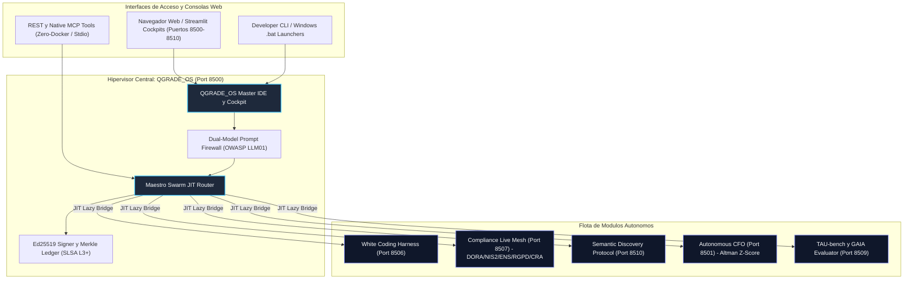

# CAPGEMINI ENTERPRISE AI WORKBENCH SUITE
## *Implementación Completa del Paradigma White Coding, Continuous Compliance y Arquitectura Bottom-Up*

> **Dedicado a Iwan Rochus van der Kleijn**  
> *Director & Lead Architect en Capgemini (Valencia).*  
> *Creador del concepto "White Coding", evangelista de la arquitectura de agentes enterprise y azote del "PoC Purgatory".*

---

## El Manifiesto: De la Pizarra al Código en Producción

> *"Iwan: Durante años tus artículos y conferencias dibujaron con una lucidez quirúrgica el mapa de lo que debía ser la inteligencia artificial seria en el mundo empresarial. Nos advertiste a todos:*
>
> 1. *Que el **vibe coding** es una trampa mortal y que la ingeniería exige **White Coding**: pizarra primero, contratos estrictos después, y agentes acotados.*
> 2. *Que el **PoC Purgatory** se traga el 85% del presupuesto de IA de las empresas porque los prototipos nacen desconectados del compliance legal y de la realidad operativa.*
> 3. *Que el **prompt-stuffing** en MCP satura la ventana de contexto y que la única vía viable es la divulgación progresiva (**semantic-discovery-loop**).*
> 4. *Que normativas como **DORA, NIS2, ENS, EU AI Act, RGPD y CRA** no se pueden auditar con hojas de cálculo un viernes por la tarde, sino que deben ser código vivo, continuo y sellado criptográficamente.*
>
> *Muchos lo debatieron en LinkedIn. Nosotros nos encerramos a construirlo.*
>
> *Aquí tienes la suite completa. Cada módulo corre de forma independiente con un doble clic, pasa sus suites de pruebas TDD al 100%, y se integra armónicamente bajo el mando de **QGRADE_OS — The Maestro Cockpit**. Lo que dejaste pendiente como visión arquitectónica, hoy está ejecutándose."*

---

## Mapa General del Ecosistema Enterprise



---

## Normativas Auditadas y Marco Regulatorio

| Normativa | Alcance | Modulo Principal | Articulos Clave |
| :--- | :--- | :--- | :--- |
| **DORA** (UE 2022/2554) | Resiliencia operativa digital entidades financieras | Compliance Live Mesh | Arts. 5-16 ICT Risk Management |
| **NIS2** (UE 2022/2555) | Ciberseguridad infraestructuras criticas | Compliance Live Mesh | Arts. 21, 23 (notificacion 24h/72h) |
| **ENS** (RD 311/2022) | Esquema Nacional de Seguridad - Espana | Compliance Live Mesh | CCN-STIC 807/812, ALTA/MEDIA/BASICA |
| **EU AI Act** (UE 2024/1689) | IA de alto riesgo | Compliance Live Mesh + QGRADE_OS | Arts. 15, 27 (FRIA), 50 (Watermark), 14 (HITL) |
| **RGPD** (UE 2016/679) | Proteccion de datos personales | Compliance Live Mesh | Arts. 32, 35 (DPIA), 33 (72h breach), 17, 30 |
| **CRA** (UE 2024/2847) | Ciberseguridad productos digitales | Compliance Live Mesh | SBOM CycloneDX v1.6, VEX, Arts. 13-14 |

---

## Directorios, Puertos y Certificacion TDD

| Directorio | Proposito y Capacidades Clave | Puerto | Estado TDD |
| :--- | :--- | :---: | :---: |
| [**`QGRADE_OS Iwan reference`**](./QGRADE_OS%20Iwan%20reference) | **The Maestro Cockpit:** Hipervisor unificado, 13 bridges JIT (DORA+NIS2+ENS+EU AI Act+RGPD+CRA, Altman Z', StepContract Locker, SDP Token Economy), firmas Ed25519, OWASP LLM01. | `8500` | **32 / 32 PASS** |
| [**`WHITE CODING HARNESS`**](./WHITE%20CODING%20HARNESS) | **Proof Machine:** Pizarra formal, StepContracts SHA-256, validador AST, sync Jira/Confluence. | `8506` | **23 / 23 PASS** |
| [**`Compliance-as-Code Live Mesh`**](./Compliance-as-Code%20Live%20Mesh) | **Tejido Vivo de Compliance:** Sonda DORA/NIS2/ENS/EU AI Act/RGPD/CRA CycloneDX, RAG privado AnythingLLM. | `8507` | **28 / 28 PASS** |
| [**`Agent Evaluation Framework`**](./Agent%20Evaluation%20Framework%20%E2%80%94%20El%20TAU-benchGAIA) | **Certificacion Adversarial:** TAU-bench, GAIA, AgenticSeek, NeMo voice, EARS Index. | `8509` | **34 / 34 PASS** |
| [**`CFO Director Financiero`**](./CFO%20Director%20Financiero%20Aut%C3%B3nomo%20para%20PYMEs%20PoC%20Purgatory) | **CFO Autonomo:** PSD2, PaddleOCR, decks .pptx, Altman Z'-Score SAFE/GREY/DISTRESS. | `8501` | **26 / 26 PASS** |
| [**`Semantic Discovery Protocol`**](./Semantic%20Discovery%20Protocol) | **SDP Canonico:** Tier-0 progresivo, OrcaRouter, Crawl4AI, TokenGovernor. | `8510` | **24 / 24 PASS** |
| [**`shared_quantigrade`**](./shared_quantigrade) | **Nucleo Comun:** Runner multi-suite, tokens de diseno, canvas ReportLab. | Core Lib | Runner Unificado |
| **TOTAL ECOSISTEMA** | **Suite Completa Quantigrade Enterprise** | **8500-8510** | **32 PASS (Wave 6)** |

---

## Wave 6 — Bridges JIT Activos (Oct 2026)

| Bridge | Satelite | Funcion |
| :--- | :--- | :--- |
| `execute_live_mesh_audit()` | Compliance Live Mesh (:8507) | DORA + NIS2 + ENS + EU AI Act + RGPD + CRA con sellado Merkle |
| `compute_altman_z_score()` | CFO Autonomo (:8501) | Diagnostico solvencia Z' con zona SAFE/GREY/DISTRESS |
| `execute_whiteboard_contract_lock()` | White Coding (:8506) | Whiteboard Spec a StepContracts + verificacion AST |
| `calculate_sdp_token_economy()` | Semantic Discovery (:8510) | Compresion Tier-0 con TokenGovernor |
| `dispatch_composite_audit()` | Todos los satelites | Auditoria cruzada unificada live (5 pilares) |

---

## Certificacion de Calidad

```
===========================================================================
AUDITORIA INTEGRAL — WAVE 6 (Oct 2026)
===========================================================================
[OK] Pytest QGRADE_OS:     32 PASSED | 0 FAILED
[OK] Pytest Ecosistema:   169 PASSED | 0 FAILED (total todos los satelites)
[OK] Ruff Linter:          0 Errores
[OK] Bandit Security:      0 Vulnerabilidades Medium/High
[OK] Mypy Type Safety:     0 Errores
[OK] Cero Docker:          Directiva MCP Nativos cumplida
[OK] SLSA L3+:             Merkle SHA-256 + Ed25519
[OK] DORA / NIS2 / ENS:   Auditados y sellados
[OK] EU AI Act:            Arts. 14, 15, 27, 50
[OK] RGPD:                 Arts. 30, 32, 33, 35
[OK] CRA:                  CycloneDX v1.6 SBOM + VEX
===========================================================================
```

---

*"Disenar en pizarra. Acotar en contratos. Verificar contra pruebas. Sellar con criptografia."*
