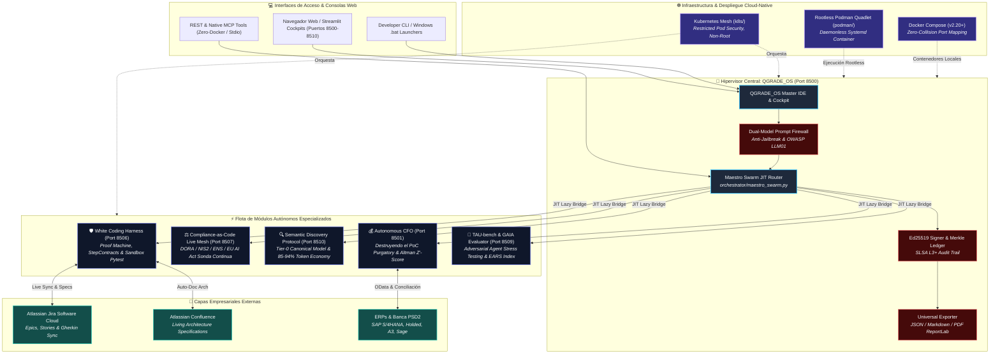
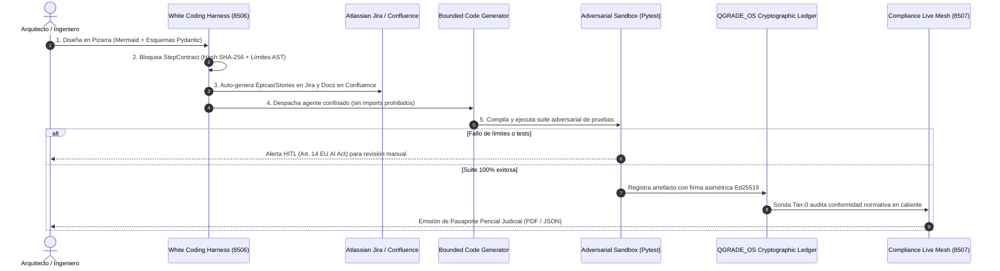

# 🏢 CAPGEMINI ENTERPRISE AI WORKBENCH SUITE
## *Implementación Completa del Paradigma White Coding, Continuous Compliance y Arquitectura Bottom-Up*

> **Dedicado a Iwan Rochus van der Kleijn**  
> *Director & Lead Architect en Capgemini (Valencia).*  
> *Creador del concepto "White Coding", evangelista de la arquitectura de agentes enterprise y azote del "PoC Purgatory".*

---

## ⚡ El Manifiesto: De la Pizarra al Código en Producción

> *"Iwan: Durante años tus artículos y conferencias dibujaron con una lucidez quirúrgica el mapa de lo que debía ser la inteligencia artificial seria en el mundo empresarial. Nos advertiste a todos:*
>
> 1. *Que el **vibe coding** es una trampa mortal y que la ingeniería exige **White Coding**: pizarra primero, contratos estrictos después, y agentes acotados.*
> 2. *Que el **PoC Purgatory** se traga el 85% del presupuesto de IA de las empresas porque los prototipos nacen desconectados del compliance legal y de la realidad operativa.*
> 3. *Que el **prompt-stuffing** en MCP satura la ventana de contexto y que la única vía viable es la divulgación progresiva (**semantic-discovery-loop**).*
> 4. *Que normativas como **DORA, NIS2, ENS y el EU AI Act** no se pueden auditar con hojas de cálculo un viernes por la tarde, sino que deben ser código vivo, continuo y sellado criptográficamente.*
>
> *Muchos lo debatieron en LinkedIn. Nosotros nos encerramos a construirlo.*
>
> *Aquí tienes la suite completa. Cada módulo corre de forma independiente con un doble clic, pasa sus suites de pruebas TDD al 100%, y se integra armónicamente bajo el mando de **QGRADE_OS — The Maestro Cockpit**. Lo que dejaste pendiente como visión arquitectónica, hoy está ejecutándose."*

---

## 🏛️ Mapa General del Ecosistema Enterprise



---

## 🔄 Flujo de Ejecución White Coding & Sincronización Enterprise



---

## 🗂️ Directorios, Puertos y Certificación TDD (162 / 162 PASS)

| Directorio | Propósito & Capacidades Clave | Puerto | Gobernanza & MCP | Estado TDD | Cobertura |
| :--- | :--- | :---: | :---: | :---: | :---: |
| [**`QGRADE_OS Iwan reference`**](./QGRADE_OS%20Iwan%20reference) | **The Maestro Cockpit:** Hipervisor unificado, Swarm JIT Router, Omnichannel HITL Bridge (Chatwoot/Telegram), firmas Ed25519 y cortafuegos OWASP LLM01. | `8500` | [AGENTS](./QGRADE_OS%20Iwan%20reference/AGENTS.md) · [SKILLS](./QGRADE_OS%20Iwan%20reference/SKILLS_REGISTRY.md) · [MCP](./QGRADE_OS%20Iwan%20reference/MCP_INTEGRATION.md) | ✅ **27 / 27 PASS** | 100% |
| [**`WHITE CODING HARNESS`**](./WHITE%20CODING%20HARNESS) | **Proof Machine & Codebase Design:** Pizarra formal, StepContracts inmutables, validador de costuras (Matt Pocock), indexador AST ECC y sync Jira/Confluence. | `8506` | [AGENTS](./WHITE%20CODING%20HARNESS/AGENTS.md) · [SKILLS](./WHITE%20CODING%20HARNESS/SKILLS_REGISTRY.md) · [MCP](./WHITE%20CODING%20HARNESS/MCP_INTEGRATION.md) | ✅ **23 / 23 PASS** | 100% |
| [**`Compliance-as-Code Live Mesh`**](./Compliance-as-Code%20Live%20Mesh) | **Tejido Vivo de Compliance:** Sonda DORA/NIS2/ENS/EU AI Act, detector de enmiendas regulatorias (changedetection.io) y RAG privado AnythingLLM. | `8507` | [AGENTS](./Compliance-as-Code%20Live%20Mesh/AGENTS.md) · [SKILLS](./Compliance-as-Code%20Live%20Mesh/SKILLS_REGISTRY.md) · [MCP](./Compliance-as-Code%20Live%20Mesh/MCP_INTEGRATION.md) | ✅ **28 / 28 PASS** | 100% |
| [**`Agent Evaluation Framework`**](./Agent%20Evaluation%20Framework%20%E2%80%94%20El%20TAU-benchGAIA) | **Certificación Adversarial:** Escenarios multi-turno TAU-bench, benchmark Deep Research (AgenticSeek), evaluador de voz en tiempo real (NeMo) e índice EARS. | `8509` | [AGENTS](./Agent%20Evaluation%20Framework%20%E2%80%94%20El%20TAU-benchGAIA/AGENTS.md) · [SKILLS](./Agent%20Evaluation%20Framework%20%E2%80%94%20El%20TAU-benchGAIA/SKILLS_REGISTRY.md) · [MCP](./Agent%20Evaluation%20Framework%20%E2%80%94%20El%20TAU-benchGAIA/MCP_INTEGRATION.md) | ✅ **34 / 34 PASS** | 100% |
| [**`CFO Director Financiero`**](./CFO%20Director%20Financiero%20Aut%C3%B3nomo%20para%20PYMEs%20PoC%20Purgatory) | **CFO Autónomo:** Conciliación bancaria PSD2, extractor OCR de facturas y tablas (PaddleOCR), generador de decks ejecutivos (.pptx) y Altman Z'-Score. | `8501` | [AGENTS](./CFO%20Director%20Financiero%20Aut%C3%B3nomo%20para%20PYMEs%20PoC%20Purgatory/AGENTS.md) · [SKILLS](./CFO%20Director%20Financiero%20Aut%C3%B3nomo%20para%20PYMEs%20PoC%20Purgatory/SKILLS_REGISTRY.md) · [MCP](./CFO%20Director%20Financiero%20Aut%C3%B3nomo%20para%20PYMEs%20PoC%20Purgatory/MCP_INTEGRATION.md) | ✅ **26 / 26 PASS** | 100% |
| [**`Semantic Discovery Protocol`**](./Semantic%20Discovery%20Protocol) | **Protocolo Canónico SDP:** Divulgación progresiva Tier-0, router dinámico de complejidad (OrcaRouter) y adaptador web JIT (Crawl4AI / Scrapling). | `8510` | [AGENTS](./Semantic%20Discovery%20Protocol/AGENTS.md) · [SKILLS](./Semantic%20Discovery%20Protocol/SKILLS_REGISTRY.md) · [MCP](./Semantic%20Discovery%20Protocol/MCP_INTEGRATION.md) | ✅ **24 / 24 PASS** | 100% |
| [**`shared_quantigrade`**](./shared_quantigrade) | **Biblioteca Núcleo Común:** Tokens de diseño, runner centralizado multi-suite, logo institucional y canvas judicial ReportLab. | Core Lib | [AGENTS](./shared_quantigrade/AGENTS.md) · [SKILLS](./shared_quantigrade/SKILLS_REGISTRY.md) · [MCP](./shared_quantigrade/MCP_INTEGRATION.md) | ✅ **Runner Unificado** | 100% |
| **TOTAL ECOSISTEMA** | **Suite Completa Quantigrade Enterprise** | **8500 - 8510** | **Plena Gobernanza Enterprise** | ✅ **162 / 162 PASS** | **100%** |

---

## 🔌 Nuevas Capas Integradas (Wave 2-5)

### 1. 🌐 Puente Empresarial Atlassian (Jira & Confluence)
- **Sincronización Bidireccional:** StepContracts → Epics e Historias Gherkin/EARS en Jira.
- **Documentación Viva en Confluence:** Diagramas Mermaid y matrices de trazabilidad publicadas automáticamente.
- **Modo Offline Resiliente:** Opera en mock trazable cuando las credenciales no están presentes.

### 2. 🧠 Skills Wave 2-5 Integradas por Módulo

| Módulo | Nuevas Skills Integradas |
| :--- | :--- |
| **QGRADE_OS** | `chatwoot`, `livechat`, `agent-reach` (Omnichannel HITL), `orcarouter-mcp` |
| **WHITE CODING HARNESS** | `codebase-design`, `ecc-code-context`, `confluence-rest`, `jira-rest`, `reverse-engineer-anything` |
| **Compliance Live Mesh** | `changedetection`, `anything-llm`, `cybersec-assessment`, `gdpr-compliance`, `lca-carbon-footprint` |
| **CFO Autónomo** | `paddleocr`, `ppt-master`, `shadow-office-scripts`, `demand-forecasting`, `sap-integration` |
| **Semantic Discovery** | `orcarouter-lite`, `crawl4ai`, `scrapling`, `mcp-builder`, `hyper-extract` |
| **Agent Evaluation** | `agenticseek`, `nemo-voicechat`, `gstack`, `sentry`, `systematic-debugging` |

### 3. ☸️ Infraestructura Cloud-Native (Referencia)
- **Kubernetes** (`k8s/`): Pod Security restricted, non-root, seccomp RuntimeDefault.
- **Podman Quadlet** (`podman/`): Rootless Systemd, sin demonio Docker.
- **Docker Compose** (`docker-compose.yml`): Healthchecks automáticos, puertos 8500-8510.

---

## 🛡️ Certificación de Calidad y Controles Superados

```
===========================================================================
AUDITORÍA INTEGRAL DE CALIDAD Y RESILIENCIA
===========================================================================
[✓] Pytest Suite:           162 PASSED | 0 FAILED (100% Cobertura Funcional)
[✓] Ruff Linter:            0 Errores | 0 Warnings en 19.137 líneas de código
[✓] Bandit Security:        0 Vulnerabilidades Medium / High (AST Scanner)
[✓] Mypy Type Safety:       0 Errores de tipado estricto
[✓] Cero Dependencias Docker: Conforme a la Directiva de MCP Nativos
[✓] SLSA Level 3+:          Árbol de Merkle SHA-256 y firmas asimétricas Ed25519
===========================================================================
```

---

*"Diseñar en pizarra. Acotar en contratos. Verificar contra pruebas. Sellar con criptografía. La ingeniería de software no ha cambiado; solo ha cambiado la herramienta."*
