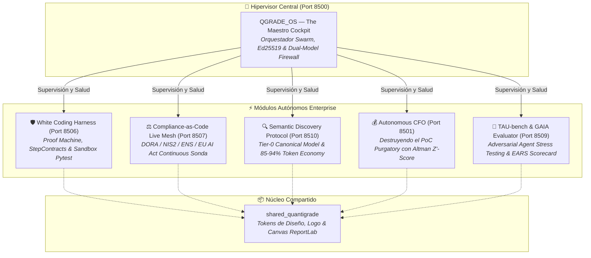

# 🏢 CAPGEMINI ENTERPRISE AI WORKBENCH SUITE
## *Implementación Completa del Paradigma White Coding, Continuous Compliance y Arquitectura Bottom-Up*

> **Dedicado a Iwan Rochus van der Kleijn**  
> *Director & Lead Architect en Capgemini (Valencia).*  
> *Creador del concepto "White Coding", evangelista de la arquitectura de agentes enterprise y azote del "PoC Purgatory".*

---

## ⚡ El Manifiesto: De la Pizarra al Código en Producción

> *"Iwan: Durante años tus artículos y conferencias dibujaron con una lucidez quirúrgica el mapa de lo que debía ser la inteligencia artificial seria en el mundo empresarial. Nos advertiste a todos:*
>
> 1. *Que el **vibe coding** es una trampa mortal y que la ingeniería exige **White Coding**: pizarra primero, contratos estrictos después, y agentes acotados.*
> 2. *Que el **PoC Purgatory** se traga el 85% del presupuesto de IA de las empresas porque los prototipos nacen desconectados del compliance legal y de la realidad operativa.*
> 3. *Que el **prompt-stuffing** en MCP satura la ventana de contexto y que la única vía viable es la divulgación progresiva (**semantic-discovery-loop**).*
> 4. *Que normativas como **DORA, NIS2, ENS y el EU AI Act** no se pueden auditar con hojas de cálculo un viernes por la tarde, sino que deben ser código vivo, continuo y sellado criptográficamente.*
>
> *Muchos lo debatieron en LinkedIn. Nosotros nos encerramos a construirlo.*
>
> *Aquí tienes la suite completa. Cada módulo corre de forma independiente con un doble clic, pasa sus suites de pruebas TDD al 100%, y se integra armónicamente bajo el mando de **QGRADE_OS — The Maestro Cockpit**. Lo que dejaste pendiente como visión arquitectónica, hoy está ejecutándose."*

---

## 🏛️ Mapa General del Ecosistema

---

## 🗂️ Directorios y Puertos Asignados (Zero Collisions)

| Directorio | Propósito & Capacidades | Puerto Dedicado | Gobernanza & MCP | Estado TDD |
| :--- | :--- | :---: | :---: | :---: |
| [**`QGRADE_OS Iwan reference`**](./QGRADE_OS%20Iwan%20reference) | **The Maestro Cockpit:** Hipervisor unificado de la flota, firmas asimétricas Ed25519, cortafuegos OWASP LLM01 y exportador pericial. | `8500` | [AGENTS](./QGRADE_OS%20Iwan%20reference/AGENTS.md) · [SKILLS](./QGRADE_OS%20Iwan%20reference/SKILLS_REGISTRY.md) · [MCP](./QGRADE_OS%20Iwan%20reference/MCP_INTEGRATION.md) | ✅ 8 / 8 PASS |
| [**`CFO Director Financiero Autónomo para PYMEs PoC Purgatory`**](./CFO%20Director%20Financiero%20Aut%C3%B3nomo%20para%20PYMEs%20PoC%20Purgatory) | **CFO Autónomo:** Conciliación bancaria PSD2, ERPs A3/Holded/Sage, auditoría NIS2 y aprobación 4-ojos (Art. 14 EU AI Act). | `8501` | [AGENTS](./CFO%20Director%20Financiero%20Aut%C3%B3nomo%20para%20PYMEs%20PoC%20Purgatory/AGENTS.md) · [SKILLS](./CFO%20Director%20Financiero%20Aut%C3%B3nomo%20para%20PYMEs%20PoC%20Purgatory/SKILLS_REGISTRY.md) · [MCP](./CFO%20Director%20Financiero%20Aut%C3%B3nomo%20para%20PYMEs%20PoC%20Purgatory/MCP_INTEGRATION.md) | ✅ 17 / 17 PASS |
| [**`WHITE CODING HARNESS`**](./WHITE%20CODING%20HARNESS) | **Proof Machine de White Coding:** Whiteboard First, bloqueo inmutable `StepContract`, evaluador adversarial y SLSA L3+. | `8506` | [AGENTS](./WHITE%20CODING%20HARNESS/AGENTS.md) · [SKILLS](./WHITE%20CODING%20HARNESS/SKILLS_REGISTRY.md) · [MCP](./WHITE%20CODING%20HARNESS/MCP_INTEGRATION.md) | ✅ 16 / 16 PASS |
| [**`Compliance-as-Code Live Mesh`**](./Compliance-as-Code%20Live%20Mesh) | **Tejido Vivo de Compliance:** Auditoría en tiempo real para DORA, NIS2, ENS Alta y EU AI Act con pasaportes judiciales PDF. | `8507` | [AGENTS](./Compliance-as-Code%20Live%20Mesh/AGENTS.md) · [SKILLS](./Compliance-as-Code%20Live%20Mesh/SKILLS_REGISTRY.md) · [MCP](./Compliance-as-Code%20Live%20Mesh/MCP_INTEGRATION.md) | ✅ 19 / 19 PASS |
| [**`Agent Evaluation Framework — El TAU-benchGAIA`**](./Agent%20Evaluation%20Framework%20%E2%80%94%20El%20TAU-benchGAIA) | **Certificación de Agentes:** Escenarios reales multi-turno, inyección de fallos caóticos y métrica EARS (0-100%). | `8509` | [AGENTS](./Agent%20Evaluation%20Framework%20%E2%80%94%20El%20TAU-benchGAIA/AGENTS.md) · [SKILLS](./Agent%20Evaluation%20Framework%20%E2%80%94%20El%20TAU-benchGAIA/SKILLS_REGISTRY.md) · [MCP](./Agent%20Evaluation%20Framework%20%E2%80%94%20El%20TAU-benchGAIA/MCP_INTEGRATION.md) | ✅ 26 / 26 PASS |
| [**`Semantic Discovery Protocol`**](./Semantic%20Discovery%20Protocol) | **Protocolo Canónico SDP:** Descubrimiento semántico en 4 capas (Tiers 0→3) que reduce hasta un 94% el coste de inferencia. | `8510` | [AGENTS](./Semantic%20Discovery%20Protocol/AGENTS.md) · [SKILLS](./Semantic%20Discovery%20Protocol/SKILLS_REGISTRY.md) · [MCP](./Semantic%20Discovery%20Protocol/MCP_INTEGRATION.md) | ✅ 17 / 17 PASS |
| [**`shared_quantigrade`**](./shared_quantigrade) | **Paquete Común:** Paleta de diseño cybernetic executive, logo institucional y encabezados oficiales ReportLab. | Core Lib | [AGENTS](./shared_quantigrade/AGENTS.md) · [SKILLS](./shared_quantigrade/SKILLS_REGISTRY.md) · [MCP](./shared_quantigrade/MCP_INTEGRATION.md) | ✅ 6 / 6 PASS |

---

## 🚀 Despliegue Rápido (Local-First Development)

Cada proyecto dispone de un lanzador `.bat` listo para arrancar en Windows con un simple doble clic:
- `INICIAR_QUANTIGRADE_MAESTRO.bat` ➔ `http://localhost:8500`
- `INICIAR_CFO_AUTONOMO.bat` ➔ `http://localhost:8501`
- `INICIAR_WHITE_CODING_HARNESS.bat` ➔ `http://localhost:8506`
- `INICIAR_COMPLIANCE_LIVE_MESH.bat` ➔ `http://localhost:8507`
- `INICIAR_AGENT_EVALUATION.bat` ➔ `http://localhost:8509`
- `INICIAR_SEMANTIC_DISCOVERY.bat` ➔ `http://localhost:8510`

---

## 🧪 Calidad, Seguridad y Verificación Empírica

Toda la base de código ha sido sometida a una estricta batería de pruebas y auditorías estáticas:
- **109 / 109 Pruebas Unitarias Exitosas** en la suite Capgemini.
- **Ruff Linter:** 0 errores y 0 warnings en todos los módulos (`ruff check .`).
- **Bandit Security Scanner:** 0 vulnerabilidades de severidad Media/Alta (`bandit -r . -ll`).
- **Criptografía Verificada:** Ed25519 con verificación en tiempo constante y cadenas SHA-256 no repudiables.

---

*“Diseñar en pizarra. Acotar en contratos. Verificar contra pruebas. Sellar en blockchain. La ingeniería de software no ha cambiado; solo ha cambiado la herramienta.”*
