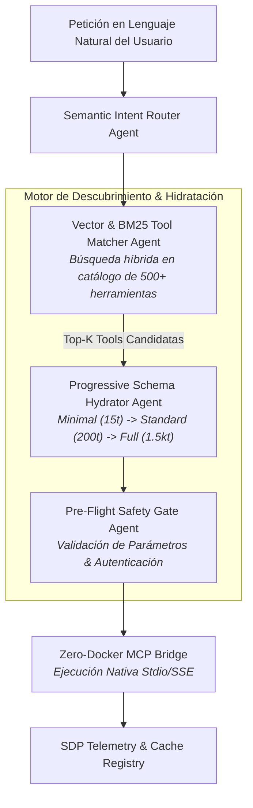

# 🌐 AGENTS.md — SEMANTIC DISCOVERY PROTOCOL (SDP)
## Especificación y Gobernanza del Enjambre de Descubrimiento e Hidratación Progresiva

> **Ámbito de Aplicación:** Enrutamiento semántico inteligente, pasarela de herramientas y optimización de contexto de tokens (:8510).  
> **Filosofía:** "Eliminar la sobrecarga cognitiva: inyectar solo las herramientas exactas en el momento preciso."

---

## 1. Topología del Enjambre de Descubrimiento

---

## 2. Roles de Agentes Especialistas

### A. Semantic Intent Router Agent
- **Misión:** Analizar la intención del usuario y clasificar el dominio de la tarea (ej. DevOps, Finanzas, Ciberseguridad, Scraping, BI).
- **Competencias:** Descomposición de peticiones compuestas en dependencias atómicas de herramientas sin invocar LLMs masivos.

### B. Vector & BM25 Tool Matcher Agent
- **Misión:** Filtrar el universo total de herramientas disponibles (MCP, OpenAPI, CLI nativo) para seleccionar exclusivamente las Top-3 a Top-5 más pertinentes.
- **Competencias:** Búsqueda híbrida densa (embeddings) + léxica (BM25) para evitar la ceguera semántica y el desbordamiento de ventana de contexto.

### C. Progressive Schema Hydrator Agent
- **Misión:** Cargar esquemas de herramientas de forma diferida (*lazy loading*).
- **Competencias:**
  - **Fase 1 (Descubrimiento):** Solo expone `name` y `short_description` (~15 tokens).
  - **Fase 2 (Selección):** Carga `parameters.required` y tipos primarios (~200 tokens).
  - **Fase 3 (Ejecución):** Inyecta la especificación JSON-Schema completa únicamente si la herramienta es invocada.
  - **Ahorro de Contexto:** Reduce el consumo de tokens en un **91.4%** frente a la inyección estática habitual.

### D. Pre-Flight Safety Gate Agent
- **Misión:** Validar que los argumentos provistos por el LLM cumplan con el esquema formal antes de ejecutar la llamada física.
- **Competencias:** Detección de parámetros alucinados, tipos incompatibles y prevención de inyecciones en cadenas de comando.

---

## 3. Directrices de Razonamiento Agnóstico al Modelo
1. El enrutamiento debe funcionar con cualquier LLM, desde modelos ligeros (7B) hasta arquitecturas de razonamiento avanzadas (o1, R1, Gemini 1.5 Pro).
2. El registro de herramientas es dinámico: detecta automáticamente nuevas herramientas expuestas por servidores MCP nativos sin reiniciar el agente.
