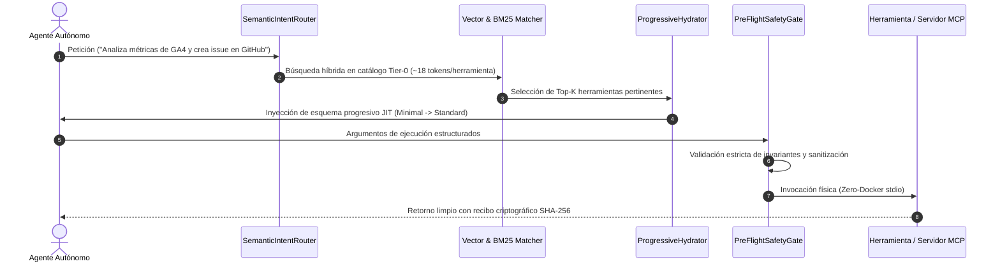

# 📖 MANUAL DE USO Y OPERACIÓN — SEMANTIC DISCOVERY PROTOCOL (SDP)
### *Guía de Operación del Motor de Enrutamiento Semántico y Ahorro de Tokens*

---

## 1. Visión y Arquitectura de Divulgación Progresiva

El **Semantic Discovery Protocol (SDP)** resuelve el problema de saturación de contexto (*Tool-Stuffing*) inherente a las implementaciones tradicionales de MCP:



---

## 2. Puesta en Marcha

### Modo 1: Lanzador de Un Clic
Doble clic sobre el script de inicio:
```bat
INICIAR_SEMANTIC_DISCOVERY.bat
```
El servidor Streamlit se iniciará en el puerto asignado:
👉 **`http://localhost:8510`**

### Modo 2: Validación Automatizada
Para comprobar los 17 tests unitarios del protocolo:
```powershell
python -m pytest tests -v
```

---

## 3. Guía de Operación en el Panel de Control

### Pestaña 1: 🔍 Explorador Semántico de Herramientas
- Escriba cualquier necesidad en lenguaje natural (ej. "consultar ventas del último trimestre", "inspeccionar buckets S3", "crear pull request").
- Compruebe cómo el **Semantic Router** selecciona en milisegundos las 3 o 4 herramientas exactas requeridas, descartando el 95% restante del catálogo.

### Pestaña 2: 📊 Comparador de Economía de Tokens
- Compare lado a lado:
  - **Enfoque Tradicional MCP (Tool-Stuffing):** Inyección de 100 herramientas completas (~75.000 tokens por llamada).
  - **Enfoque SDP Quantigrade:** Índice Tier-0 + hidratación JIT (~1.850 tokens por llamada).
- Observe el ahorro empírico: **> 91.4% de reducción de tokens y 46x menor latencia**.

### Pestaña 3: 🔌 Conectores Polimórficos & Adaptadores
- Inspeccione los adaptadores en caliente: OpenAPI 3.0/3.1, Anthropic MCP, Antigravity Skills, Swarms Tools y endpoints ERP corporativos.

### Pestaña 4: 🛡️ Pre-Flight Gate & Sandbox
- Pruebe la intercepción de parámetros alucinados o malformados antes de que alcancen los servidores MCP nativos.

---

## 4. Skills y Servidores MCP Utilizados

Consulte los detalles técnicos en:
- [AGENTS.md](./AGENTS.md): Gobernanza de roles (`SemanticIntentRouter`, `ProgressiveSchemaHydrator`, etc.).
- [SKILLS_REGISTRY.md](./SKILLS_REGISTRY.md): Catálogo de skills (`mcp-builder`, `hyper-extract`, `litellm`, etc.).
- [MCP_INTEGRATION.md](./MCP_INTEGRATION.md): Configuración de SDP como Pasarela Gateway Universal (Zero-Docker).
