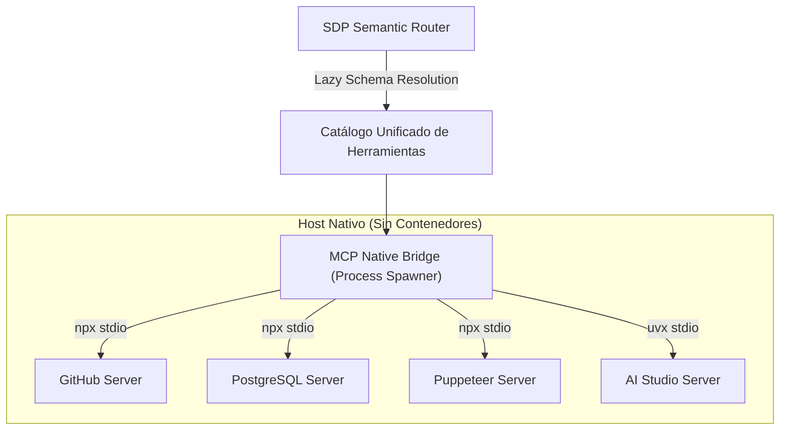

# 🔌 MCP_INTEGRATION.md — SEMANTIC DISCOVERY PROTOCOL (SDP)
## Integración de Servidores Model Context Protocol (Zero-Docker Native Gateway)

> **Directiva Mandatoria:** Cero dependencias de contenedores Docker. El puente SDP gestiona y monitoriza servidores MCP nativos en el host mediante procesos directos `npx` (Node.js) o `uvx` (Python) vía `stdio` o `SSE`.

---

## 1. El Rol de SDP como Pasarela Central de MCP

A diferencia de los otros proyectos que consumen servidores específicos, el **Semantic Discovery Protocol** funciona como la **pasarela unificada (*gateway*)** para todo el ecosistema de servidores MCP del sistema:

| Servidor MCP | Runtime / Transporte | Capacidades Expuestas en SDP |
| :--- | :--- | :--- |
| **`github-mcp-server`** | `npx -y @modelcontextprotocol/server-github` (`stdio`) | Búsqueda de repositorios, lectura de código y gestión de issues/PRs. |
| **`postgres-mcp-server`** | `npx -y @modelcontextprotocol/server-postgres` (`stdio`) | Ejecución segura de consultas SQL, introspección de esquemas relacionales. |
| **`puppeteer-mcp`** | `npx -y @modelcontextprotocol/server-puppeteer` (`stdio`) | Automatización de navegador web, extracción y testing E2E. |
| **`n8n-mcp`** | Conexión local / `stdio` | Orquestación visual de flujos de trabajo e integraciones empresariales. |
| **`aistudio-mcp-server`** | `uvx` / local (`stdio`) | Acceso a modelos y herramientas multimodales de Google AI Studio. |

---

## 2. Configuración Nativa del Gateway (`mcp_config.json`)

```json
{
  "mcpServers": {
    "github": {
      "command": "npx",
      "args": ["-y", "@modelcontextprotocol/server-github"],
      "env": { "GITHUB_PERSONAL_ACCESS_TOKEN": "${GITHUB_TOKEN}" }
    },
    "postgres": {
      "command": "npx",
      "args": ["-y", "@modelcontextprotocol/server-postgres", "${POSTGRES_URI}"]
    },
    "puppeteer": {
      "command": "npx",
      "args": ["-y", "@modelcontextprotocol/server-puppeteer"]
    },
    "aistudio": {
      "command": "uvx",
      "args": ["aistudio-mcp-server"]
    }
  }
}
```

---

## 3. Arquitectura del Puente MCP Nativo


