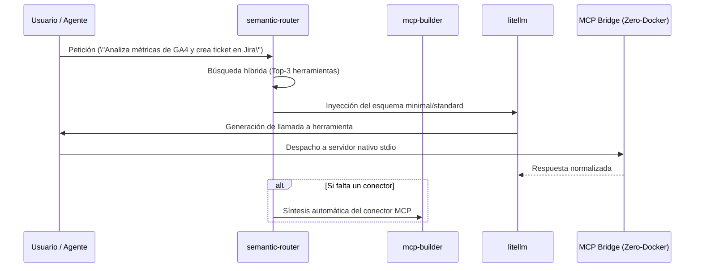

# SKILLS_REGISTRY.md — SEMANTIC DISCOVERY PROTOCOL (SDP)
## Catálogo de Skills Especializadas y Protocolos de Enrutamiento Dinámico

> **Sistema:** Semantic Discovery Protocol (:8510) 
> **Ámbito:** Descubrimiento dinámico de herramientas, optimización de tokens y generación de conectores MCP 

---

## 1. Mapeo de Skills Especializadas

| Skill | Categoría | Propósito en el Motor SDP | Gatillo / Contexto de Uso |
| :--- | :--- | :--- | :--- |
| **`mcp-builder`** | Ingeniería de Protocolo | Guía y scaffolding para compilar, probar y validar servidores MCP a partir de especificaciones OpenAPI y REST. | Creación de nuevos adaptadores de servicios externos. |
| **`hyper-extract`** | Ingesta Estructurada | Parseo y extracción determinista de documentación técnica y schemas de APIs a modelos Pydantic de SDP. | Registro de nuevas APIs en el catálogo de herramientas. |
| **`litellm`** | Interoperabilidad Multimodelo | Normalización del dialecto de llamada a funciones (*tool calling*) entre OpenAI, Claude, Gemini y modelos locales. | Invocación de herramientas independientemente del modelo subyacente. |
| **`ponytail`** | Minimalismo & Eficiencia | Enfoque de código ultra-ligero y libre de sobrecostes (YAGNI) para la pasarela de herramientas. | Optimización de latencia en los adaptadores del puente. |
| **`code-doctor`** | Fiabilidad de Código | Verificación de tipado estricto (Mypy) y ausencia de inyecciones en los wrappers de ejecución. | CI/CD y despliegue de nuevos conectores SDP. |
| **`orcarouter-lite`** | Asignación de Tokens | Asignación dinámica de modelos por nivel de complejidad (Tier-0 Fast vs Tier-3 Reasoning). | Enrutamiento de peticiones según nivel SDP. |
| **`crawl4ai`** | Ingesta Web Progresiva | Encapsulamiento de recursos web en manifiestos Tier-0 con hidratación JIT sin saturar contexto. | Ingesta y consulta de documentación web en vivo. |

---

## 2. Flujo de Descubrimiento e Hidratación Progresiva

