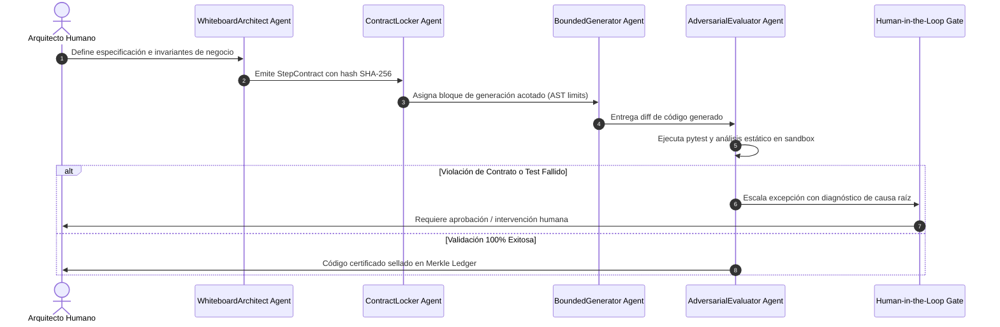

# AGENTS.md — WHITE CODING HARNESS
## Especificación y Gobernanza de Agentes del Proof Machine

> **Ámbito de Aplicación:** Confinamiento y Validación Formal de Código (Puerto 8506). 
> **Arquitectura:** Agnóstica al modelo de lenguaje (compatible con Anthropic Claude, Google Gemini, OpenAI, DeepSeek y modelos locales). 
> **Filosofía:** "Whiteboard First, StepContract Locking, Bounded Generation, Adversarial Pytest".

---

## 1. Topología de Agentes de White Coding

El flujo de trabajo confina estrictamente a los agentes generadores dentro de los límites impuestos por los arquitectos en la pizarra:

---

## 2. Roles y Responsabilidades

### A. WhiteboardArchitect Agent
- **Misión:** Modelar los diagramas de secuencia, esquemas Pydantic y restricciones del sistema antes de autorizar la escritura de una sola línea de código.
- **Invariantes:**
 - Prohibido saltar a generación sin especificación formal.
 - Toda dependencia debe estar explícitamente declarada.

### B. ContractLocker Agent
- **Misión:** Traducir la pizarra a un objeto `StepContract` inmutable, calculando su digest SHA-256 e inspeccionando el AST para fijar imports prohibidos y presupuestos de líneas.
- **Invariantes:**
 - Inmutabilidad del contrato una vez sellado.

### C. BoundedGenerator Agent
- **Misión:** Escribir el código estrictamente necesario para satisfacer el contrato asignado, respetando el principio de minimalismo radical (`ponytail`).
- **Invariantes:**
 - Ningún import fuera de la lista blanca permitida.
 - Cero código especulativo o sobre-ingeniería (YAGNI estricto).

### D. AdversarialEvaluator Agent
- **Misión:** Intentar romper el código generado ejecutando suites de pruebas `pytest` en un sandbox aislado, validando tipos y escaneando vulnerabilidades de seguridad.
- **Invariantes:**
 - Si un test falla, el código se rechaza inmediatamente sin excusas.

### E. CodebaseDesign & Seam Inspector Agent
- **Misión:** Auditar la profundidad modular (`depth_ratio`), validar el **Deletion Test** (los llamadores no acceden a miembros privados `_`) y verificar que las pruebas atacan exclusivamente la superficie pública del seam.
- **Invariantes:**
 - Prohibido acoplar tests a miembros privados.

### F. Jira & Confluence Enterprise Sync Agent
- **Misión:** Sincronizar automáticamente especificaciones y StepContracts sellados con Jira Software Cloud (Épicas, Stories, criterios Gherkin) y Confluence (documentación viva de arquitectura).
- **Invariantes:**
 - Trazabilidad bidireccional entre ticket Jira, hash SHA-256 y commit.
