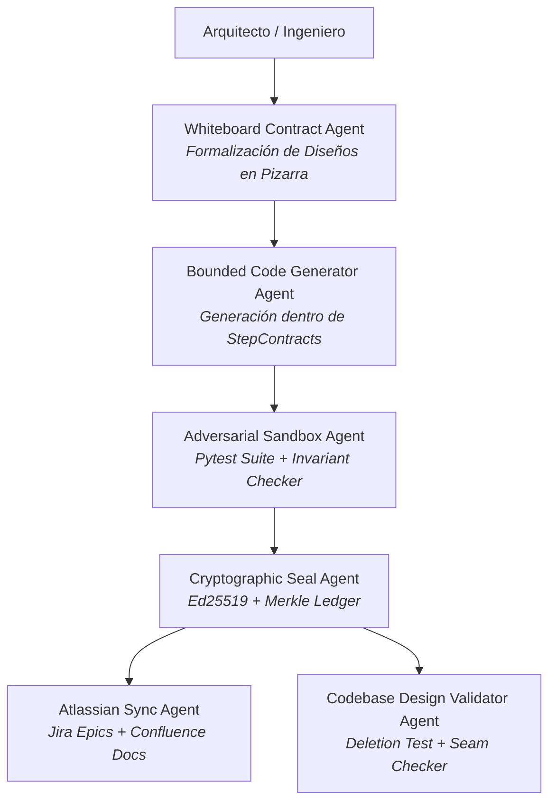

# 🛡️ AGENTS.md — WHITE CODING HARNESS
## Especificación de Agentes de la Proof Machine

> **Ámbito:** Proof Machine & Codebase Design (Puerto 8506).  
> **Filosofía:** Pizarra primero, contratos inmutables, generación acotada y sandbox adversarial.

---

## 1. Topología de Agentes

---

## 2. Roles de Agente

### A. Whiteboard Contract Agent
- **Misión:** Transformar diseños en pizarra (Mermaid + Pydantic) en StepContracts inmutables SHA-256.
- **Skills:** `openspec-propose`, `writing-plans`, `codebase-design`

### B. Bounded Code Generator Agent
- **Misión:** Generar código estrictamente dentro de los límites AST definidos en el StepContract.
- **Skills:** `ponytail`, `test-driven-development`, `ecc-code-context`

### C. Adversarial Sandbox Agent
- **Misión:** Ejecutar suite Pytest adversarial y verificar invariantes de módulos.
- **Skills:** `code-doctor`, `systematic-debugging`, `verification-before-completion`

### D. Codebase Design Validator Agent
- **Misión:** Validar que cada módulo supera el Deletion Test y tiene costuras desacopladas.
- **Skills:** `codebase-design`, `ecc-code-context`

### E. Atlassian Sync Agent
- **Misión:** Publicar StepContracts como Épicas en Jira y documentación técnica en Confluence.
- **Skills:** `jira-rest`, `confluence-rest`
- **MCP:** `atlassian-mcp`

---

## 3. Gate HITL (Art. 14 EU AI Act)

Ningún agente puede:
1. Alterar un StepContract ya sellado criptográficamente.
2. Aprobar código que no supere el 100% de la suite adversarial.
3. Publicar en Jira/Confluence sin firma Ed25519 válida del Ledger.
