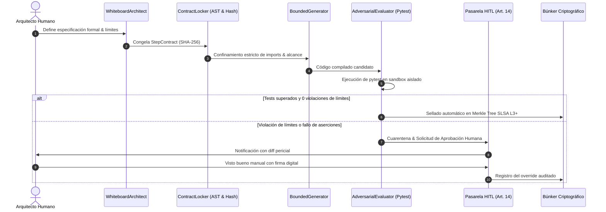

# 📖 MANUAL DE USO Y OPERACIÓN — WHITE CODING HARNESS
### *Guía de Operación de la Máquina de Demostración Formal (Proof Machine)*

---

## 1. Visión y Flujo del Paradigma

El **White Coding Harness** materializa la visión de Iwan van der Kleijn frente a la fragilidad del *vibe coding*:
> *"El código no se genera en el vacío. Primero se dibuja en la pizarra, luego se bloquea en un contrato estricto, después se acota al generador y finalmente un evaluador hostil intenta romperlo con pruebas antes de que ningún humano dé su visto bueno."*



---

## 2. Puesta en Marcha

### Modo 1: Lanzador de Un Clic
Doble clic sobre el script de inicio:
```bat
INICIAR_WHITE_CODING_HARNESS.bat
```
El servidor Streamlit se iniciará en el puerto asignado:
👉 **`http://localhost:8506`**

### Modo 2: Validación de Pruebas TDD
Para ejecutar las pruebas del arnés desde consola:
```powershell
python -m pytest tests -v
```

---

## 3. Guía de Operación en el Panel de Control

### Paso 1: Pizarra Formal (`Whiteboard First`)
1. Seleccione un caso de uso (ej. `Microservicio Bancario PSD2`, `Módulo de Conciliación Contable`).
2. Defina los límites invariantes:
   - Módulos prohibidos (ej. `os.system`, `subprocess`, llamadas de red sin autorización).
   - Presupuesto máximo de líneas y complejidad ciclomática.
3. Observe cómo el arnés genera automáticamente el diagrama Mermaid de secuencia y la especificación Pydantic.

### Paso 2: Bloqueo de Contrato (`Contract Lock`)
1. Pulse en **"Congelar StepContract"**.
2. El sistema calcula el hash SHA-256 inmutable de la especificación.
3. A partir de este momento, cualquier intento de un agente de cambiar el diseño o importar librerías fuera de contrato será detectado por el analizador de sintaxis abstracta (AST).

### Paso 3: Generación Acotada & Evaluación Adversarial
1. Ejecute la generación de código.
2. El arnés inyecta el código en `agent_workspace/sandbox/`.
3. El **Adversarial Evaluator** dispara `pytest` de forma aislada, reportando el paso/fallo de cada aserción sin depender de la "opinión" del LLM.

### Paso 4: Visto Bueno Humano (HITL Gate)
- Si una prueba falla o se detecta un intento de desvío arquitectónico, la pasarela de intervención humana (Art. 14 EU AI Act) entra en juego: el arquitecto revisa el informe forense y autoriza o refactoriza.

---

## 4. Skills y Servidores MCP Utilizados

Consulte los detalles técnicos en:
- [AGENTS.md](./AGENTS.md): Gobernanza de roles (`WhiteboardArchitect`, `ContractLocker`, `BoundedGenerator`, etc.).
- [SKILLS_REGISTRY.md](./SKILLS_REGISTRY.md): Catálogo de skills (`test-driven-development`, `code-doctor`, `ponytail`, etc.).
- [MCP_INTEGRATION.md](./MCP_INTEGRATION.md): Integración con `github-mcp-server`, `puppeteer-mcp` y `rea` (Reverse Engineering).
