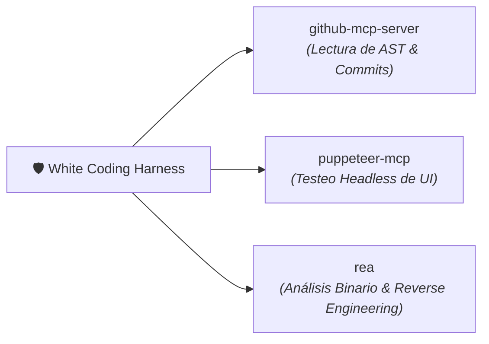

# 🔌 MCP_INTEGRATION.md — WHITE CODING HARNESS
## Integración de Servidores Model Context Protocol Nativos (Zero Docker)

> **Estándar:** Model Context Protocol (Anthropic/Open-Source)  
> **Directiva:** 100% Nativo sin Docker. Transporte mediante `stdio` local (`npx`, `uvx`) o URLs remotas `SSE`.

---

## 1. Servidores MCP Asignados a White Coding



---

## 2. Configuración Nativa en `mcp_config.json`

```json
{
  "mcpServers": {
    "github-mcp-server": {
      "command": "npx",
      "args": ["-y", "@modelcontextprotocol/server-github"],
      "env": {
        "GITHUB_PERSONAL_ACCESS_TOKEN": "YOUR_GITHUB_TOKEN"
      }
    },
    "puppeteer-mcp": {
      "command": "npx",
      "args": ["-y", "@modelcontextprotocol/server-puppeteer"]
    },
    "rea": {
      "command": "node",
      "args": ["path/to/rea.mjs", "mcp"]
    }
  }
}
```

---

## 3. Catálogo de Herramientas y Casos de Uso

| Servidor MCP | Herramienta | Utilidad en White Coding |
| :--- | :--- | :--- |
| `github-mcp-server` | `get_file_contents` | Carga inmutable de archivos de referencia para el diseño de la pizarra. |
| `github-mcp-server` | `search_code` | Análisis de impacto antes de bloquear un contrato de arquitectura. |
| `puppeteer-mcp` | `navigate` & `click` | Verificación end-to-end de interfaces frontend tras superar el evaluador adversarial. |
| `rea` | `decompile_inspect` | Análisis forense de librerías de terceros para descartar malware o vulnerabilidades ocultas. |
