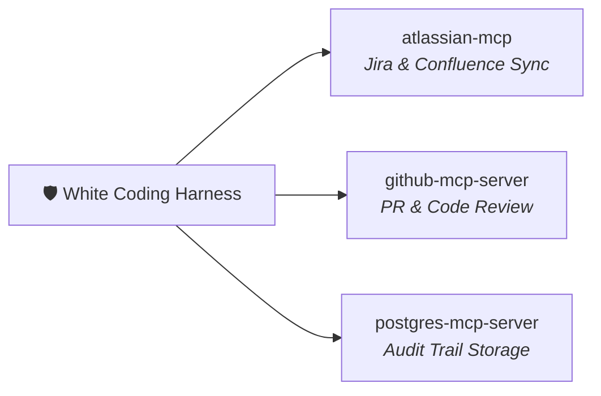

# 🔌 MCP_INTEGRATION.md — WHITE CODING HARNESS
## Servidores MCP Nativos (Zero Docker)

---

## Servidores MCP Asignados



## Configuración `mcp_config.json`

```json
{
  "mcpServers": {
    "atlassian-mcp": {
      "command": "npx",
      "args": ["-y", "@modelcontextprotocol/server-atlassian"],
      "env": {
        "ATLASSIAN_URL": "https://your-org.atlassian.net",
        "ATLASSIAN_EMAIL": "your-email@company.com",
        "ATLASSIAN_API_TOKEN": "YOUR_ATLASSIAN_TOKEN"
      }
    },
    "github-mcp-server": {
      "command": "npx",
      "args": ["-y", "@modelcontextprotocol/server-github"],
      "env": { "GITHUB_PERSONAL_ACCESS_TOKEN": "YOUR_GITHUB_TOKEN" }
    }
  }
}
```

## Herramientas Expuestas

| Servidor MCP | Herramienta | Propósito |
| :--- | :--- | :--- |
| `atlassian-mcp` | `create_issue` | Crear Épicas/Stories desde StepContracts. |
| `atlassian-mcp` | `create_page` | Publicar arquitectura técnica en Confluence. |
| `github-mcp-server` | `create_pull_request` | PRs automáticos tras sellado criptográfico. |
