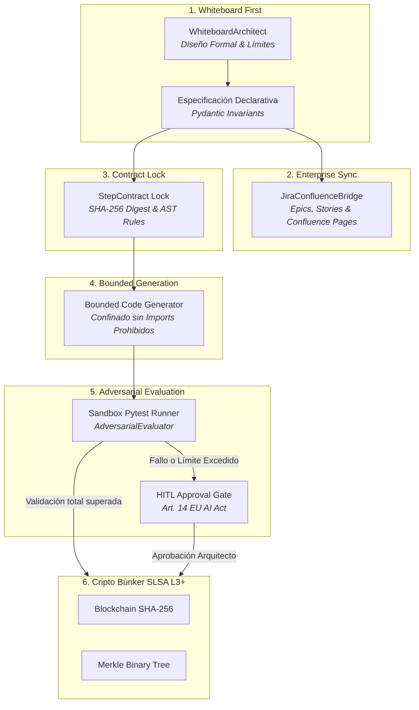

# WHITE CODING HARNESS (Proof Machine MVP)

> **Implementación de Referencia del Paradigma *White Coding* (Iwan Rochus van der Kleijn - Lead Architect & Director en Capgemini).**

---

## ¿Qué es White Coding?

El término **White Coding** fue acuñado por Iwan van der Kleijn como el antídoto arquitectónico al *vibe coding* (generación descontrolada de código mediante prompts sin inspección, diseño previo ni límites estrictos).

En lugar de delegar a ciegas en LLMs o agentes no acotados:
1. **Whiteboard First:** Humanos y arquitectos diseñan formalmente en la pizarra: diagramas de secuencia/arquitectura (Mermaid), esquemas de datos (Pydantic/JSON Schema), invariantes y límites de contorno (imports prohibidos, presupuestos de archivos).
2. **Contract Lock:** La pizarra se traduce en contratos de paso inmutables (`StepContract`) con sellado criptográfico SHA-256.
3. **Bounded Generation:** Los agentes programadores operan confinados estrictamente dentro de la caja de arena y los límites de su contrato.
4. **Adversarial Evaluation:** Un evaluador independiente compila el código, ejecuta pruebas unitarias reales con `pytest` en un sandbox aislado y valida la conformidad AST/estática.
5. **Human-in-the-Loop (HITL) Gate:** Cualquier intento de violación de límites o desviación arquitectónica bloquea el despliegue y genera un ticket de aprobación humana.


## Documentación Técnica & Gobernanza
- [**Manual de Uso y Operación Detallado**](./MANUAL_DE_USO.md)
- [**Especificación y Gobernanza de Agentes (AGENTS.md)**](./AGENTS.md)
- [**Catálogo de Skills Asignadas (SKILLS_REGISTRY.md)**](./SKILLS_REGISTRY.md)
- [**Integración de Servidores MCP Nativos (MCP_INTEGRATION.md)**](./MCP_INTEGRATION.md)

---

## Inicio Rápido (Doble Clic)

Simplemente ejecute el archivo:
```bat
INICIAR_WHITE_CODING_HARNESS.bat
```
El servidor ejecutivo Streamlit se iniciará automáticamente en:
**http://localhost:8506**

---

## Ejecución de Pruebas Automatizadas (23 / 23 PASS)

Para validar todos los subsistemas (especificación formal, StepContracts inmutables, validador de costuras arquitectónicas, indexador AST ECC, límites AST, evaluador adversarial, búnker criptográfico y puente Jira/Confluence):
```powershell
python -m pytest tests -v
```

```
tests/test_white_coding_suite.py::test_whiteboard_architecture_generation PASSED
tests/test_white_coding_suite.py::test_step_contract_lock_and_hash PASSED
tests/test_white_coding_suite.py::test_contract_locker_forbidden_imports PASSED
tests/test_white_coding_suite.py::test_bounded_code_generator_success PASSED
tests/test_white_coding_suite.py::test_adversarial_evaluator_valid_code PASSED
tests/test_white_coding_suite.py::test_adversarial_evaluator_broken_code PASSED
tests/test_white_coding_suite.py::test_hitl_gate_approval_workflow PASSED
tests/test_white_coding_suite.py::test_sha256_ledger_chaining PASSED
tests/test_white_coding_suite.py::test_merkle_sealer_root PASSED
tests/test_white_coding_suite.py::test_full_white_coding_cycle PASSED
tests/test_jira_confluence_bridge.py::test_jira_issue_generation PASSED
tests/test_jira_confluence_bridge.py::test_confluence_page_generation PASSED
tests/test_jira_confluence_bridge.py::test_bridge_sync_cycle PASSED
tests/test_codebase_design_and_ecc.py::test_seam_validator_deep_module PASSED
tests/test_codebase_design_and_ecc.py::test_seam_validator_shallow_warning PASSED
tests/test_codebase_design_and_ecc.py::test_ecc_context_generation PASSED
tests/test_wave1_enhancements.py::test_langgraph_checkpoint_engine PASSED
tests/test_wave1_enhancements.py::test_semgrep_analyzer_rule_detection PASSED
tests/test_wave1_enhancements.py::test_legacy_decompiler_clean_code PASSED
...
============================== 23 passed in 2.35s ==============================
```

---

## Alineación Regulatoria Oficial

| Regulación | Ámbito | Implementación Técnica | Estado |
| :--- | :--- | :--- | :---: |
| **EU AI Act Art. 14** | Supervisión Humana Efectiva (HITL) | Interceptación `hitl_gate.py` ante violaciones de contrato o límites. | **Conforme** |
| **EU AI Act Art. 12** | Trazabilidad & Registros Automáticos | Sellado criptográfico de cada generación con hash SHA-256 inmutable. | **Conforme** |
| **ENS (RD 311/2022)** | Esquema Nacional de Seguridad | Árbol binario de Merkle y ledger auditable de cambios (SLSA L3+). | **Conforme** |
| **NIS2 Art. 21** | Seguridad en la Cadena de Suministro | Análisis estático AST y prohibición de imports no confiables. | **Conforme** |
| **CRA** | Cyber Resilience Act | Validación de interfaces de código y costuras limpias sin dependencias ocultas. | **Conforme** |

## Estructura del Proyecto

```
WHITE CODING HARNESS/
├── INICIAR_WHITE_CODING_HARNESS.bat # Lanzador ejecutable (Puerto 8506)
├── README.md # Este documento
├── app_streamlit.py # Consola Ejecutiva Streamlit
├── make_shortcut.py # Generador de acceso directo en escritorio
├── requirements.txt # Dependencias Python
│
├── core/ # Núcleo de Orquestación y Contratos
│ ├── whiteboard_architect.py # Generador de especificaciones y Mermaid
│ ├── contract_locker.py # Bloqueo de StepContract y análisis AST
│ ├── bounded_generator.py # Generador de código confinado
│ ├── adversarial_evaluator.py # Evaluador adversarial y ejecutor de pruebas
│ ├── hitl_gate.py # Centro de aprobaciones Human-in-the-Loop
│ ├── jira_confluence_bridge.py # Puente bidireccional Atlassian Jira & Confluence
│ └── telemetry.py # ContextThreadPoolExecutor y OpenTelemetry
│
├── provenance/ # Trazabilidad Criptográfica
│ ├── sha256_ledger.py # Cadena de bloques inmutable
│ └── merkle_sealer.py # Árbol binario de Merkle (SLSA L3+)
│
├── agent_workspace/sandbox/ # Directorio aislado de ejecución y pruebas
└── tests/ # Suite de pruebas unitarias pytest (19 pruebas)
```
