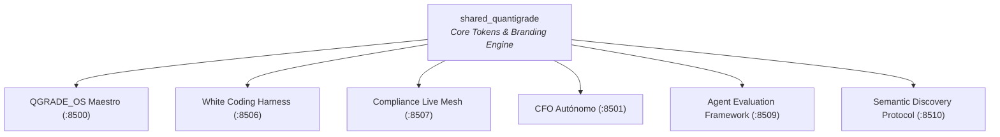

# 🎨 AGENTS.md — SHARED QUANTIGRADE (CORE BRAND & IDENTITY)
## Especificación del Núcleo Compartido de Identidad de Marca y UI/UX

> **Ámbito de Aplicación:** Librería central compartida por todos los microservicios y aplicaciones Quantigrade.  
> **Filosofía:** "Consistencia visual y de experiencia sin fisuras en toda la suite."

---

## 1. Misión del Núcleo Compartido

El módulo `shared_quantigrade` no ejecuta agentes autónomos de forma aislada, sino que actúa como el **sustrato compartido** que gobierna la apariencia visual, la identidad de marca institucional, los tokens de diseño y la generación de pasaportes y dossiers PDF oficiales con firma y marca de agua.

---

## 2. Contratos de Interfaz del Núcleo
1. `branding.apply_quantigrade_theme()`: Inyección de paleta institucional (Cyber Blue `#00D2FF`, Deep Navy `#0A1128`, Glassmorphism) en todas las interfaces Streamlit.
2. `pdf_branding.add_header_footer()`: Renderizado uniforme de cabeceras, logotipos y firmas de validez pericial en todos los documentos exportados.
