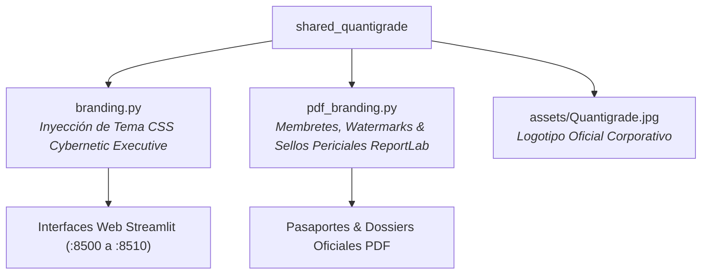

# 📖 MANUAL DE USO Y OPERACIÓN — SHARED QUANTIGRADE
### *Guía de Integración del Núcleo de Marca, Tokens de Diseño y PDF Branding*

---

## 1. Visión y Utilidad del Módulo Compartido

`shared_quantigrade` es el paquete Python que garantiza la **identidad visual homogénea, los estándares de diseño y la validez pericial de los documentos emitidos** en todo el ecosistema:



---

## 2. Puesta en Marcha e Integración

### En Aplicaciones Streamlit:
```python
import streamlit as st
from shared_quantigrade.branding import apply_quantigrade_theme

# Inyecta paleta oficial (#00D2FF, #0A1128, Glassmorphism) y cabecera
apply_quantigrade_theme(
    service_name="Mi Servicio Autónomo",
    service_port=8500
)
```

### En Generación de Informes Periciales PDF (ReportLab):
```python
from shared_quantigrade.pdf_branding import add_quantigrade_header_footer

# Aplica membrete oficial, paginación dinámica y hash de integridad judicial
add_quantigrade_header_footer(canvas, doc, title="Certificado Oficial de Cumplimiento")
```

---

## 3. Validación de Tests

```powershell
python -m pytest tests -v
```
Garantiza que la paleta cromática, los archivos de recursos y los puertos de escucha de toda la flota estén libres de colisiones.
