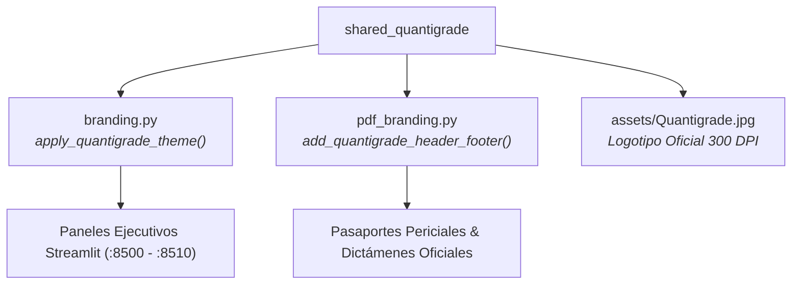

# SHARED QUANTIGRADE FOUNDATION
### *Núcleo Compartido de Identidad Visual, Tokens de Diseño y Sellado Pericial ReportLab*

---

## Visión y Propósito

`shared_quantigrade` es la librería transversal que alimenta a los 6 microservicios del ecosistema Capgemini Quantigrade. Proporciona consistencia visual de alta fidelidad (Glassmorphism, Cyber Blue `#00D2FF`, Navy `#0A1128`), carga unificada del logotipo corporativo y funciones de paginación y foliado judicial para los pasaportes emitidos en PDF.



---

## Documentación Técnica & Gobernanza
- [**Manual de Uso y Operación Detallado**](./MANUAL_DE_USO.md)
- [**Especificación y Gobernanza de Agentes (AGENTS.md)**](./AGENTS.md)
- [**Catálogo de Skills Asignadas (SKILLS_REGISTRY.md)**](./SKILLS_REGISTRY.md)
- [**Integración de Servidores MCP Nativos (MCP_INTEGRATION.md)**](./MCP_INTEGRATION.md)

---

## Pruebas Unitarias y Runner Maestro

### Suite Local del Módulo:
```powershell
python -m pytest tests -v
```
Verifica la integridad de tokens, paleta cromática, asset gráfico del logotipo oficial y la ausencia de colisiones de puertos en toda la suite.

### Runner Centralizado del Ecosistema (169 / 169 PASS):
`shared_quantigrade` aloja el ejecutor maestro que certifica en paralelo todas las suites de pruebas de los 6 proyectos:
```powershell
python shared_quantigrade/run_all_tests.py
```

```
===========================================================================
EXECUTIVE RESULTS SUMMARY
===========================================================================
Project                                                 | Passed | Status
---------------------------------------------------------------------------
WHITE CODING HARNESS                                    | 23     | PASSED
Agent Evaluation Framework — El TAU-benchGAIA           | 34     | PASSED
Compliance-as-Code Live Mesh                            | 30     | PASSED
CFO Director Financiero Autónomo para PYMEs PoC Purgatory | 26     | PASSED
Semantic Discovery Protocol                             | 24     | PASSED
QGRADE_OS Iwan reference                                | 32     | PASSED
---------------------------------------------------------------------------
TOTAL TESTS: 169 PASSED | 0 FAILED (100% SUCCESS RATE)
===========================================================================
```

---

## Matriz Oficial de Cobertura Regulatoria

| Marco Normativo | Base Legal | Implementación Técnica | Estado |
| :--- | :--- | :--- | :---: |
| **ENS (RD 311/2022)** | Esquema Nacional de Seguridad | Paginación y foliado judicial formal en ReportLab con metadatos no repudiables. | **Conforme** |
| **EU AI Act Art. 12 & 13** | Reglamento UE 2024/1689 | Transparencia corporativa y generación estandarizada de pasaportes periciales. | **Conforme** |
| **CRA & NIS2** | Directivas Europeas de Ciberseguridad | Runner determinista sin dependencias ocultas y reporte consolidado de salud TIC. | **Conforme** |
