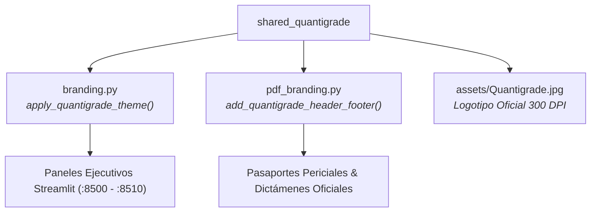

# 📦 SHARED QUANTIGRADE FOUNDATION
### *Núcleo Compartido de Identidad Visual, Tokens de Diseño y Sellado Pericial ReportLab*

---

## 🏛️ Visión y Propósito

`shared_quantigrade` es la librería transversal que alimenta a los 6 microservicios del ecosistema Capgemini Quantigrade. Proporciona consistencia visual de alta fidelidad (Glassmorphism, Cyber Blue `#00D2FF`, Navy `#0A1128`), carga unificada del logotipo corporativo y funciones de paginación y foliado judicial para los pasaportes emitidos en PDF.



---

## 📚 Documentación Técnica & Gobernanza
- 📖 [**Manual de Uso y Operación Detallado**](./MANUAL_DE_USO.md)
- 🤖 [**Especificación y Gobernanza de Agentes (AGENTS.md)**](./AGENTS.md)
- 🛠️ [**Catálogo de Skills Asignadas (SKILLS_REGISTRY.md)**](./SKILLS_REGISTRY.md)
- 🔌 [**Integración de Servidores MCP Nativos (MCP_INTEGRATION.md)**](./MCP_INTEGRATION.md)

---

## 🧪 Pruebas Unitarias

```powershell
python -m pytest tests -v
```
Verifica la integridad de colores, el asset gráfico y la ausencia de colisiones de puertos en toda la suite.
